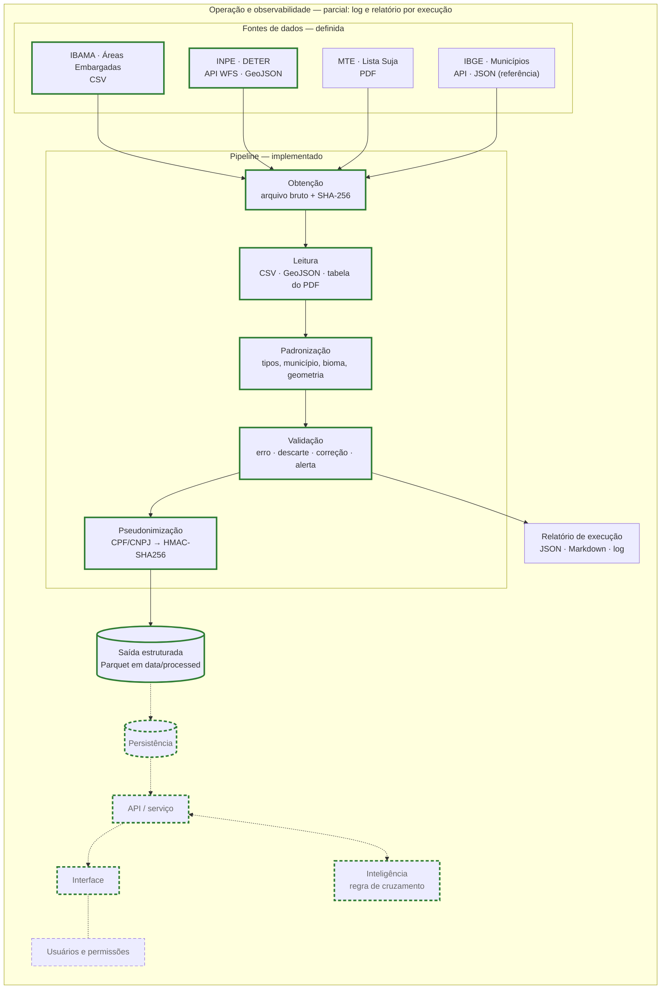

# Arquitetura

Versão 1 — 13/09/2026 (Atividade 02).

## O que este documento cobre

Segue a arquitetura de referência da disciplina (Aula 01): as camadas **fontes de dados, pipeline, persistência, API/serviço e interface**, mais a camada de **inteligência** (chamada pela API), **usuários e permissões** (ligada à interface) e **operação e observabilidade** (envolve todas).

Para cada camada, o documento registra:
- o que ela faz neste projeto;
- se já está definida ou apenas prevista;
- onde entra a inteligência;
- qual é a parte mais arriscada;
- qual é a fatia vertical.

Nesta versão só **fontes de dados** e **pipeline** estão definidas, porque foram implementadas. As demais camadas são previstas e serão decididas nas aulas correspondentes. Decisões com alternativas reais ficam registradas em [`adr/`](adr/).

## Visão geral

Linha tracejada = camada prevista. Borda verde = fatia vertical.

## Camadas

| Camada | Papel no projeto | Estado |
|---|---|---|
| Fontes de dados | Bases públicas que indicam pendência socioambiental (embargo, desmatamento, trabalho análogo ao de escravo) e a referência de municípios | **Definida** |
| Pipeline | Transformar cada fonte bruta em tabela validada, tipada e sem dados pessoais | **Implementado** (`pipeline/`) |
| Persistência | Guardar ocorrências e avaliações com histórico e permitir consulta espacial | Prevista — Aula 04 |
| API / serviço | Responder, por produtor, quais pendências existem e com qual evidência | Prevista — Aula 05 |
| Interface | Painel para o técnico priorizar produtores | Prevista — Aulas 06 e 07 |
| Usuários e permissões | Cada técnico vê apenas os produtores que atende | Prevista — Aula 08 |
| Inteligência | Regra de cruzamento como linha de base. ML ou LLM entram só se a regra se mostrar insuficiente na avaliação | Prevista — Aulas 09 a 11 |
| Operação e observabilidade | Execução agendada, monitoramento e implantação | Parcial: log e relatório por execução; o restante está previsto para as Aulas 12 a 14 |

## Fontes de dados

| Fonte | Tipo | Acesso | Recorte nesta versão | Bruto guardado em |
|---|---|---|---|---|
| IBAMA — Áreas Embargadas | Tabular (CSV) | Download direto, sem autenticação | Base completa | `data/raw/areas_embargadas.csv` |
| INPE — DETER Amazônia e Cerrado | API (WFS, GeoJSON) | Uma requisição por mês de imagem, sem autenticação | Classes de desmatamento com imagem desde 01/01/2021 | `data/raw/inpe_deter/<camada>/desde_<data>/<AAAA-MM>.json.gz` |
| MTE — Cadastro de Empregadores | Documento (PDF) | Download direto do gov.br | Documento completo | `data/raw/lista_suja.pdf` |
| IBGE — Municípios | API (JSON) | Requisição única, sem autenticação | Lista completa | `data/raw/ibge_municipios.json` |

Cada arquivo bruto tem ao lado um `.meta.json` com URL, data do download, cabeçalho HTTP e SHA-256. As respostas do DETER têm um `manifesto.json` com o filtro usado, o total anunciado pelo serviço e o hash de cada mês.

A referência do IBGE entrou nesta versão porque a camada Cerrado do DETER não traz código de município ([ADR 0005](adr/0005-resolver-municipio-dos-alertas-deter-pela-referencia-do-ibge.md)).

## Pipeline

Execução: `python -m pipeline`. Cada fonte é processada de forma independente, e a falha de uma não impede as outras. A exceção é a referência do IBGE: sem ela, IBAMA e DETER são registrados como erro. O processo termina com código 1 se alguma fonte falhar.

**Etapas**

1. **Obtenção:** baixa o arquivo ou as respostas mensais da API, ou reutiliza o que já foi baixado, e registra a procedência.
2. **Leitura:** CSV lido todo como texto, GeoJSON convertido em linhas, tabela do PDF segmentada em cabeçalho, título e registro.
3. **Padronização:** datas, números com vírgula decimal, nomes de município pelo IBGE, biomas, geometrias em WKT.
4. **Validação:** cada regra tem um código e uma severidade com tratamento fixo:
   - `erro`: a fonte é interrompida (estrutura ou identificador comprometidos);
   - `descarte`: o registro sai da tabela principal e vai para um arquivo de descartados com o motivo;
   - `correcao`: o valor é ajustado de forma determinística e a contagem é registrada;
   - `alerta`: o registro é mantido, o campo inválido é anulado quando for o caso e o código vai para a coluna `alertas`.
5. **Pseudonimização:** o CPF/CNPJ é substituído por HMAC-SHA256 e o nome da pessoa é removido.
6. **Saída:** Parquet em `data/processed/`, mais o relatório `relatorio_execucao.json` e `.md`, e o log em `data/logs/`.

**Saídas**

| Arquivo | Conteúdo |
|---|---|
| `ibama_embargos.parquet` | Um embargo por linha |
| `ibama_embargos_descartados.parquet` | Embargos descartados, com motivo |
| `inpe_deter_alertas.parquet` | Um alerta de desmatamento (ou trecho municipal de um alerta) por linha |
| `inpe_deter_alertas_descartados.parquet` | Alertas descartados, com motivo |
| `mte_lista_suja.parquet` | Um registro do cadastro por linha |
| `ibge_municipios.parquet` | Tabela de referência de municípios |

A saída é Parquet porque preserva tipos (datas, inteiros com ausentes, booleanos) e ocupa menos espaço que CSV. Serve de contrato com a camada de persistência, que ainda não foi definida.

**Decisões**

- [0001 — Marcar registros inválidos e descartar só o que não pode ser vinculado nem localizado](adr/0001-marcar-registros-invalidos-e-descartar-so-o-inutilizavel.md)
- [0002 — Pseudonimizar CPF/CNPJ com HMAC-SHA256 dentro do pipeline](adr/0002-pseudonimizar-cpf-cnpj-com-hmac-no-pipeline.md)
- [0003 — Identificar embargos pela combinação número, série e sequencial do termo](adr/0003-identificar-embargos-por-numero-serie-e-sequencial.md)
- [0004 — Coletar alertas DETER de desmatamento em partições mensais e identificar cada alerta pelo conteúdo](adr/0004-coletar-alertas-deter-em-particoes-mensais-e-identificar-pelo-conteudo.md)
- [0005 — Resolver o município dos alertas DETER pela referência do IBGE](adr/0005-resolver-municipio-dos-alertas-deter-pela-referencia-do-ibge.md)
- [0006 — Extrair a Lista Suja diretamente do PDF oficial](adr/0006-extrair-a-lista-suja-diretamente-do-pdf-oficial.md)

## Onde entra a inteligência

A primeira versão será uma **regra de cruzamento**, que é explicável e serve de linha de base. Ela vai combinar três vínculos:
- documento do produtor com embargos e com a Lista Suja;
- localização informada com os alertas de desmatamento posteriores a 31/12/2020;
- município como contexto.

Modelos entram depois só se a avaliação mostrar que a regra falha, por exemplo em vincular registros sem documento válido.

## Parte mais arriscada

A parte mais arriscada é a **vinculação de uma ocorrência ao produtor certo**. As bases não trazem o código do CAR, parte dos embargos não tem localização e o DETER não identifica o responsável.

O pipeline reduz esse risco antes das próximas camadas:
- documentos com dígito verificador inválido não entram no cruzamento;
- o município é padronizado pelo IBGE;
- geometrias impossíveis são anuladas.

O que ainda falta é a localização da área de produção, que terá de ser informada pelo produtor.

## Fatia vertical

Embargos do IBAMA e alertas do DETER passam pelo pipeline, entram na persistência e são cruzados por uma regra para um conjunto de produtores de teste. Uma consulta na API devolve as pendências com a fonte de cada uma, e uma tela as mostra ao técnico.

Nesta versão, a fatia está pronta até a saída do pipeline.

## Histórico

| Versão | Data | Mudança | Justificativa |
|---|---|---|---|
| 0 | Aula 01 | Camadas de referência como hipótese, sem desenho registrado | — |
| 1 | 13/09/2026 | Fontes de dados e pipeline definidos e implementados | Atividade 02 |
| 1 | 13/09/2026 | Entrou a referência de municípios do IBGE como fonte | O DETER Cerrado não traz código de município; sem a referência não há junção com o IBAMA |
| 1 | 13/09/2026 | A coleta do DETER passou a ser feita por mês, sem paginação | A paginação ordenada por `gid`, que não é único, repetia registros na fronteira das páginas |
| 1 | 13/09/2026 | O alerta DETER passou a ser identificado pelo conteúdo (gid, data, município, geometria) | O `gid` repete para trechos de um alerta em municípios vizinhos (Cerrado) e é reutilizado por alertas diferentes (Amazônia) |
| 1 | 13/09/2026 | A pseudonimização ficou dentro do pipeline | Dados pessoais não devem chegar às camadas seguintes |
| 1 | 13/09/2026 | Registros inválidos são marcados em vez de removidos | A decisão sobre usar ou não um registro com problema pertence à regra de cruzamento, não ao pipeline |
