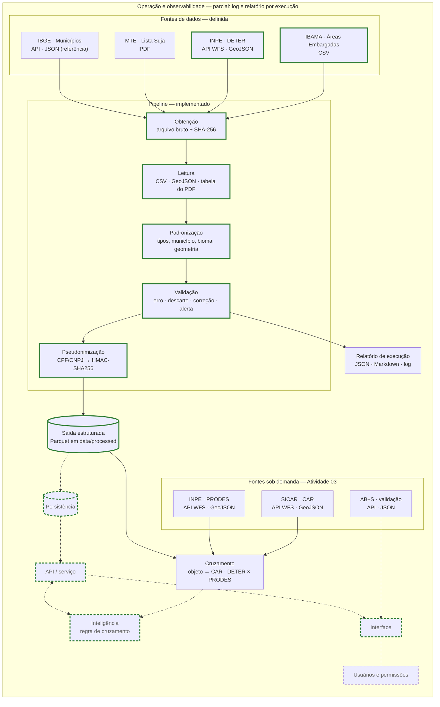

# Arquitetura

Versão 4 — 30/10/2026 (Atividade 04, Brasil inteiro e áreas protegidas). Versão 3 — 30/10/2026 (Atividade 04). Versão 2 — 14/10/2026 (Atividade 03). Versão 1 — 13/09/2026 (Atividade 02).

## O que este documento cobre

Segue a arquitetura de referência da disciplina (Aula 01): as camadas **fontes de dados, pipeline, persistência, API/serviço e interface**, mais a camada de **inteligência** (chamada pela API), **usuários e permissões** (ligada à interface) e **operação e observabilidade** (envolve todas).

Para cada camada, o documento registra:
- o que ela faz neste projeto;
- se já está definida ou apenas prevista;
- onde entra a inteligência;
- qual é a parte mais arriscada;
- qual é a fatia vertical.

Nesta versão **fontes de dados** e **pipeline** estão definidas, porque foram implementadas, e a **regra de cruzamento** existe como pré-diagnóstico por imóvel, com saída em ficha HTML (Atividade 04). As demais camadas são previstas e serão decididas nas aulas correspondentes. Decisões com alternativas reais ficam registradas em [`adr/`](adr/).

## Visão geral

Linha tracejada = camada prevista. Borda verde = fatia vertical.

## Camadas

| Camada | Papel no projeto | Estado |
|---|---|---|
| Fontes de dados | Bases públicas que indicam pendência socioambiental (embargo, desmatamento, trabalho análogo ao de escravo) e a referência de municípios | **Definida** |
| Pipeline | Transformar cada fonte bruta em tabela validada, tipada e sem dados pessoais | **Implementado** (`pipeline/`) |
| Persistência | Guardar ocorrências e avaliações com histórico e permitir consulta espacial | **Parquet particionado por UF**, sem custo (30/10/2026); PostgreSQL + PostGIS adiado para quando houver API e mais de um usuário ([ADR 0011](adr/0011-persistir-em-parquet-por-uf-e-adiar-o-postgis.md)) |
| API / serviço | Responder, por produtor, quais pendências existem e com qual evidência | Prevista — Aula 05 |
| Interface | Painel para o técnico priorizar produtores | Prevista — Aulas 06 e 07 |
| Usuários e permissões | Cada técnico vê apenas os produtores que atende | Prevista — Aula 08 |
| Inteligência | Regra de cruzamento como linha de base. ML ou LLM entram só se a regra se mostrar insuficiente na avaliação | Regra implementada em `pipeline/prediagnostico.py` (Atividade 04), sem gabarito independente; ML e LLM previstos para as Aulas 09 a 11 |
| Operação e observabilidade | Execução agendada, monitoramento e implantação | Parcial: log e relatório por execução; verificação mensal do PRODES pelo `crontab` (ADR 0011). O restante está previsto para as Aulas 12 a 14 |

## Fontes de dados

| Fonte | Tipo | Acesso | Recorte nesta versão | Bruto guardado em |
|---|---|---|---|---|
| IBAMA — Áreas Embargadas | Tabular (CSV) | Download direto, sem autenticação | Base completa | `data/raw/areas_embargadas.csv` |
| INPE — DETER Amazônia e Cerrado | API (WFS, GeoJSON) | Uma requisição por mês de imagem, sem autenticação | Classes de desmatamento com imagem desde 01/01/2021 | `data/raw/inpe_deter/<camada>/desde_<data>/<AAAA-MM>.json.gz` |
| MTE — Cadastro de Empregadores | Documento (PDF) | Download direto do gov.br | Documento completo | `data/raw/lista_suja.pdf` |
| IBGE — Municípios | API (JSON) | Requisição única, sem autenticação | Lista completa | `data/raw/ibge_municipios.json` |
| INPE — PRODES (lote, Atividade 04) | API (WFS, GeoJSON) | Contagem por ano a cada 30 dias; baixa só o que mudou e o último publicado ([ADR 0010](adr/0010-persistir-o-prodes-em-lote-e-verificar-a-publicacao-todo-mes.md)); retângulo da UF dividido em partes ([ADR 0013](adr/0013-cobrir-o-brasil-inteiro-sem-aceitar-dado-incompleto-como-limpo.md)) | Seis biomas, anos desde 2019, por UF: começa em MG e ganha a UF de cada imóvel consultado; UF pelo contorno do IBGE | `data/raw/inpe_prodes/lote/`, com `manifesto.json`; saída em `data/processed/inpe_prodes/uf=XX/` |
| IBGE e INPE — contorno das UFs e dos biomas | API (GeoJSON) | Requisição única | Brasil | `data/raw/ibge_malha_ufs.geojson`, `data/raw/inpe_biomas.geojson` |
| FUNAI — terras indígenas | API (WFS, GeoJSON) | Requisição única com `count`; cadeia de certificado completada pelo AIA ([ADR 0014](adr/0014-verificar-terras-indigenas-quilombolas-e-unidades-de-conservacao-por-sobreposicao.md)) | Brasil (665) | `data/raw/funai/` |
| MMA — unidades de conservação (CNUC) | Shapefile | Recurso escolhido pelo CKAN | Brasil (3.301) | `data/raw/cnuc/` |
| IBGE — territórios quilombolas (Censo 2022) | Shapefile | Download direto | Brasil (495) | `data/raw/ibge_territorios_quilombolas.zip` |

Cada arquivo bruto tem ao lado um `.meta.json` com URL, data do download, cabeçalho HTTP e SHA-256. As respostas do DETER têm um `manifesto.json` com o filtro usado, o total anunciado pelo serviço e o hash de cada mês.

A referência do IBGE entrou nesta versão porque a camada Cerrado do DETER não traz código de município ([ADR 0005](adr/0005-resolver-municipio-dos-alertas-deter-pela-referencia-do-ibge.md)).

### Fontes sob demanda (Atividade 03)

SICAR, PRODES e AB+S não são carregados em lote: consulta-se só o que o caso toca. Não entram em `python -m pipeline` nem no relatório de execução. Cada consulta devolve o DataFrame tratado e o `ResultadoFonte`, com o mesmo tratamento e as mesmas severidades das fontes em lote, e grava a resposta bruta com um `.meta.json` (URL, parâmetros, data UTC, status HTTP, SHA-256) por `pipeline/download.consultar`. A mesma consulta repetida reaproveita o que foi gravado.

| Fonte | Tipo | Consulta | Bruto guardado em | Módulo |
|---|---|---|---|---|
| SICAR — CAR | API (WFS, GeoJSON); uma camada por UF | Por município, retângulo ou ponto; TLS antigo com certificado verificado ([ADR 0007](adr/0007-obter-o-car-pelo-wfs-publico-do-sicar.md)) | `data/raw/sicar/<uf>/` | `pipeline/fontes/sicar.py` |
| INPE — PRODES | API (WFS, GeoJSON); um workspace por bioma | Por bioma, retângulo ou UF, um ano PRODES por requisição | `data/raw/inpe_prodes/<bioma>/<recorte>/<ano>.json.gz` | `pipeline/fontes/inpe_prodes.py` |
| INPE — DETER por ano PRODES | API (WFS, GeoJSON) | Por camada e UF, um ano PRODES por requisição, para a comparação com o PRODES | `data/raw/inpe_deter/sob_demanda/` | `inpe_deter.consultar_recorte` |
| AB+S — validação do relatório | API (JSON) | Um código de autenticidade por vez, com o formato validado antes ([ADR 0008](adr/0008-usar-o-ab-s-como-referencia-sem-declarar-conformidade.md)) | `data/raw/ab_s/<endpoint>/`, com CPF/CNPJ pseudonimizados antes de gravar | `pipeline/fontes/ab_s.py` |
| IBGE — malha do município | API (GeoJSON) | Um município por vez, para conferir a posição do CAR | `data/raw/ibge_malhas/` | `sicar.malha_municipio` |

O acesso aos serviços WFS (requisição, contagem e filtros espaciais) fica em `pipeline/wfs.py`, usado pelo DETER, pelo PRODES e pelo SICAR. Nos WFS 2.0 em EPSG:4674, o filtro espacial sem SRS lê (latitude, longitude); a ordem fica em `config.ORDEM_EIXOS_FILTRO`, com teste.

O cruzamento entre fontes começa em `pipeline/cruzamento.py`: para cada embargo ou alerta, uma consulta ao SICAR pelo retângulo do objeto e a classificação de cada par objeto-CAR em principal, parcial ou tangente, com `fracao_objeto`, `fracao_car` e `largura_m`. A comparação DETER × PRODES (`inpe_prodes.confirmar_alertas`) segue a escada da [ADR 0009](adr/0009-combinar-deter-e-prodes-por-data-de-imagem-e-cobertura.md). O caderno [`notebooks/02_fontes_antes_e_depois.ipynb`](../../notebooks/02_fontes_antes_e_depois.ipynb) mostra cada fonte antes e depois do tratamento.

## Pipeline

Execução: `python -m pipeline`. Cada fonte é processada de forma independente, e a falha de uma não impede as outras. A exceção é a referência do IBGE: sem ela, IBAMA e DETER são registrados como erro. O processo termina com código 1 se alguma fonte falhar.

**Etapas**

1. **Obtenção:** baixa o arquivo ou as respostas mensais da API, ou reutiliza o que já foi baixado, e registra a procedência.
2. **Leitura:** CSV lido todo como texto, GeoJSON convertido em linhas, tabela do PDF segmentada em cabeçalho, título e registro.
3. **Padronização:** datas, números com vírgula decimal, nomes de município pelo IBGE, biomas, geometrias em WKT.
4. **Validação:** cada regra tem um código e uma severidade com tratamento fixo:
   - `erro`: a fonte é interrompida (estrutura ou identificador comprometidos);
   - `descarte`: o registro sai da tabela principal e vai para um arquivo de descartados com o motivo;
   - `correcao`: o valor é ajustado de forma determinística e a contagem é registrada;
   - `alerta`: o registro é mantido, o campo inválido é anulado quando for o caso e o código vai para a coluna `alertas`.
5. **Pseudonimização:** o CPF/CNPJ é substituído por HMAC-SHA256 e o nome da pessoa é removido.
6. **Saída:** Parquet em `data/processed/`, mais o relatório `relatorio_execucao.json` e `.md`, e o log em `data/logs/`.

**Saídas**

| Arquivo | Conteúdo |
|---|---|
| `ibama_embargos.parquet` | Um embargo por linha |
| `ibama_embargos_descartados.parquet` | Embargos descartados, com motivo |
| `inpe_deter_alertas.parquet` | Um alerta de desmatamento (ou trecho municipal de um alerta) por linha |
| `inpe_deter_alertas_descartados.parquet` | Alertas descartados, com motivo |
| `mte_lista_suja.parquet` | Um registro do cadastro por linha |
| `ibge_municipios.parquet` | Tabela de referência de municípios |

A saída é Parquet porque preserva tipos (datas, inteiros com ausentes, booleanos) e ocupa menos espaço que CSV. Serve de contrato com a camada de persistência, que ainda não foi definida.

**Decisões**

- [0001 — Marcar registros inválidos e descartar só o que não pode ser vinculado nem localizado](adr/0001-marcar-registros-invalidos-e-descartar-so-o-inutilizavel.md)
- [0002 — Pseudonimizar CPF/CNPJ com HMAC-SHA256 dentro do pipeline](adr/0002-pseudonimizar-cpf-cnpj-com-hmac-no-pipeline.md)
- [0003 — Identificar embargos pela combinação número, série e sequencial do termo](adr/0003-identificar-embargos-por-numero-serie-e-sequencial.md)
- [0004 — Coletar alertas DETER de desmatamento em partições mensais e identificar cada alerta pelo conteúdo](adr/0004-coletar-alertas-deter-em-particoes-mensais-e-identificar-pelo-conteudo.md)
- [0005 — Resolver o município dos alertas DETER pela referência do IBGE](adr/0005-resolver-municipio-dos-alertas-deter-pela-referencia-do-ibge.md)
- [0006 — Extrair a Lista Suja diretamente do PDF oficial](adr/0006-extrair-a-lista-suja-diretamente-do-pdf-oficial.md)
- [0007 — Obter o CAR pelo WFS público do SICAR e atribuir embargos e alertas pela área de interseção](adr/0007-obter-o-car-pelo-wfs-publico-do-sicar.md)
- [0008 — Usar o AB+S como referência sem declarar conformidade](adr/0008-usar-o-ab-s-como-referencia-sem-declarar-conformidade.md)
- [0009 — Combinar DETER e PRODES pela data da imagem e pela cobertura de cada bioma](adr/0009-combinar-deter-e-prodes-por-data-de-imagem-e-cobertura.md)
- [0010 — Persistir o PRODES em lote e verificar a publicação todo mês](adr/0010-persistir-o-prodes-em-lote-e-verificar-a-publicacao-todo-mes.md)
- [0011 — Persistir em Parquet particionado agora e em PostgreSQL com PostGIS depois](adr/0011-persistir-em-parquet-por-uf-e-adiar-o-postgis.md)
- [0012 — Conferir o pré-diagnóstico com o relatório AB+S do imóvel](adr/0012-conferir-o-prediagnostico-com-o-relatorio-ab-s-do-imovel.md)
- [0013 — Cobrir o Brasil inteiro sem aceitar dado incompleto como limpo](adr/0013-cobrir-o-brasil-inteiro-sem-aceitar-dado-incompleto-como-limpo.md)
- [0014 — Verificar terras indígenas, quilombolas e unidades de conservação por sobreposição](adr/0014-verificar-terras-indigenas-quilombolas-e-unidades-de-conservacao-por-sobreposicao.md)
- [0015 — Montar o PRODES e o DETER do Pantanal pelo arquivo do TerraBrasilis](adr/0015-montar-o-prodes-e-o-deter-do-pantanal-pelo-arquivo-do-terrabrasilis.md)
- [0016 — Usar a base quilombola do INCRA republicada pelo CMR/FUNAI](adr/0016-usar-a-base-quilombola-do-incra-republicada-pelo-cmr-funai.md)

## Onde entra a inteligência

A primeira versão será uma **regra de cruzamento**, que é explicável e serve de linha de base. Ela vai combinar três vínculos:
- documento do produtor com embargos e com a Lista Suja;
- localização informada com os alertas de desmatamento posteriores a 31/12/2020;
- município como contexto.

Modelos entram depois só se a avaliação mostrar que a regra falha, por exemplo em vincular registros sem documento válido.

## Parte mais arriscada

A parte mais arriscada é a **vinculação de uma ocorrência ao produtor certo**. As bases não trazem o código do CAR, parte dos embargos não tem localização e o DETER não identifica o responsável.

O pipeline reduz esse risco antes das próximas camadas:
- documentos com dígito verificador inválido não entram no cruzamento;
- o município é padronizado pelo IBGE;
- geometrias impossíveis são anuladas.

O que ainda falta é a localização da área de produção, que terá de ser informada pelo produtor.

## Fatia vertical

Embargos do IBAMA e alertas do DETER passam pelo pipeline, entram na persistência e são cruzados por uma regra para um conjunto de produtores de teste. Uma consulta na API devolve as pendências com a fonte de cada uma, e uma tela as mostra ao técnico.

Nesta versão, a fatia vai da saída do pipeline até a regra de cruzamento: `python -m pipeline.prediagnostico` gera, para um CAR, a ficha em HTML, Markdown e JSON ([demonstração](../evidencias/atividade-04/prediagnostico/index.html)). Faltam persistência, API e a tela do técnico; a ficha HTML é estática e faz as vezes da interface na demonstração. Desde 30/10/2026, a fatia funciona em qualquer UF: a UF do imóvel entra no lote do PRODES na primeira consulta (ADR 0013).

## Histórico

| Versão | Data | Mudança | Justificativa |
|---|---|---|---|
| 0 | Aula 01 | Camadas de referência como hipótese, sem desenho registrado | — |
| 1 | 13/09/2026 | Fontes de dados e pipeline definidos e implementados | Atividade 02 |
| 1 | 13/09/2026 | Entrou a referência de municípios do IBGE como fonte | O DETER Cerrado não traz código de município; sem a referência não há junção com o IBAMA |
| 1 | 13/09/2026 | A coleta do DETER passou a ser feita por mês, sem paginação | A paginação ordenada por `gid`, que não é único, repetia registros na fronteira das páginas |
| 1 | 13/09/2026 | O alerta DETER passou a ser identificado pelo conteúdo (gid, data, município, geometria) | O `gid` repete para trechos de um alerta em municípios vizinhos (Cerrado) e é reutilizado por alertas diferentes (Amazônia) |
| 1 | 13/09/2026 | A pseudonimização ficou dentro do pipeline | Dados pessoais não devem chegar às camadas seguintes |
| 1 | 13/09/2026 | Registros inválidos são marcados em vez de removidos | A decisão sobre usar ou não um registro com problema pertence à regra de cruzamento, não ao pipeline |
| 2 | 14/10/2026 | SICAR, PRODES e AB+S entraram como fontes sob demanda, com cache do bruto, e o cruzamento objeto → CAR em `pipeline/cruzamento.py` | Atividade 03: consulta-se só a área ou o relatório do caso; não há carga em massa dessas fontes |
| 3 | 30/10/2026 | Pré-diagnóstico por imóvel (`pipeline/prediagnostico.py`) com ficha HTML; PRODES do recorte persistido em lote com verificação mensal | Atividade 04: a regra de cruzamento passou a ter saída para o técnico; o último ano do PRODES estava numa constante e já estava defasado (ADR 0010) |
| 3 | 30/10/2026 | Decididos: PostgreSQL + PostGIS como persistência e serviço agendado (ADR 0011), AB+S como gabarito (ADR 0012), recorte nacional com UF pelo contorno e inconclusivo para dado incompleto (ADR 0013) | Medição de três formas de persistência e teste em um CAR por bioma: o modelo em memória não escala, e o pré-diagnóstico não funcionava fora de MG |
| 4 | 30/10/2026 | PRODES dos seis biomas em lote por UF, com a UF pelo contorno do IBGE e a UF incluída quando o imóvel chega (ADR 0013); persistência em Parquet particionado e PostGIS adiado (ADR 0011); terras indígenas, quilombolas e unidades de conservação em lote (ADR 0014) | O pré-diagnóstico não funcionava fora de MG; não pagar nada agora; 6 dos 9 critérios do AB+S estavam sem verificação |
| 5 | 02/11/2026 | PRODES das 27 UFs pelo arquivo de cada bioma e DETER do Pantanal pelo arquivo (ADR 0015); quilombola pelo INCRA via CMR/FUNAI (ADR 0016); IBAMA pelo Portal de Dados Abertos, com desembargo; carteira por planilha; rotina mensal agendada | A carga pelo WFS levava horas por UF; o CSV do IBAMA passou a responder 403; o técnico atende uma carteira, não um imóvel |
