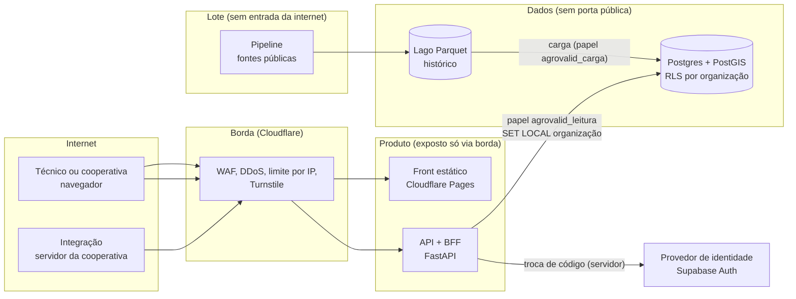
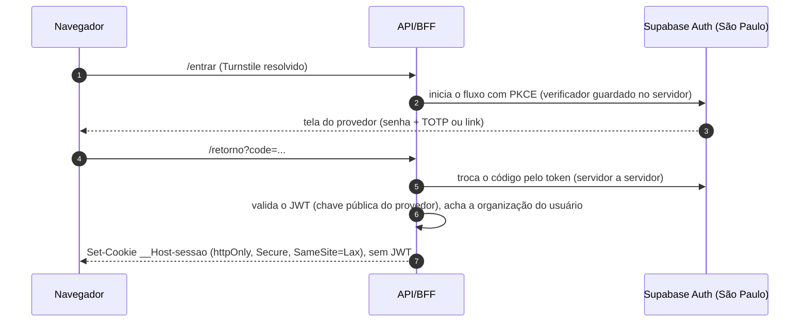

# Arquitetura-alvo da AgroValid: evolução, princípios e roteiro

Situação: **proposta em 05/11/2026, para lapidar**. Nada aqui é definitivo. Cada escolha tem opções e trade-offs nos ADRs 0019 a 0026, e pode mudar quando um fato novo aparecer. Decidido de fato até agora: FastAPI e uvicorn para a API (ADR 0020) e a chave de API por organização na primeira fase da autenticação (ADR 0021).

Este documento é o ponto de partida para a API, o front, a autenticação, a hospedagem e a LGPD. A arquitetura atual (pipeline, lago e banco) continua em [`../arquitetura.md`](../arquitetura.md).

| Documento | Assunto |
|---|---|
| [`seguranca.md`](seguranca.md) | Modelo de ameaças, controles por camada, borda (Cloudflare, limite de requisições, Turnstile), tokens, agentes de IA |
| [`ambientes-e-entrega.md`](ambientes-e-entrega.md) | Local por feature, homologação, produção, git com rebase, CI/CD, custo por fase |
| [`stack.md`](stack.md) | Tecnologias escolhidas e alternativas, com trade-offs, numa tabela só |
| [`checklist-de-issue.md`](checklist-de-issue.md) | O que toda issue nova precisa responder (segurança, LGPD, desempenho, escala) |
| [`../../lgpd/`](../../lgpd/README.md) | Módulo LGPD: papéis, bases legais, inventário, direitos do titular, incidentes, retenção e modelos de termos |

## Princípios

Em ordem de prioridade quando entram em conflito:

1. **Nada vaza.** Nenhum CPF, CNPJ, token ou segredo chega ao navegador, ao log, à URL ou a um terceiro sem contrato. O navegador recebe só o que a organização dele pode ver, já pronto para exibir.
2. **Cada camada fala só com a vizinha.** O front não conhece o banco; a API não lê o lago; o pipeline não tem porta aberta para a internet. Comprometer uma camada não entrega as outras.
3. **O banco é a última barreira.** O isolamento entre organizações é feito pela segurança por linha do Postgres (RLS), não só pelo código da API. Um erro na API não basta para uma organização ler a outra.
4. **Tudo é rastreável.** Toda resposta leva de qual execução, carga e fonte veio (ADR 0017). Todo acesso fica registrado, sem dado pessoal.
5. **Barato até dar certo, pronto para escalar quando der.** Planos gratuitos no começo; cada peça escolhida tem um próximo degrau conhecido, sem reescrever.
6. **Sem excesso de engenharia.** Um repositório, um monólito modular, um banco. Microsserviço, fila e cache distribuído só quando uma medida mostrar a necessidade.

## Camadas



| Camada | Responsável por | Não pode |
|---|---|---|
| Borda | TLS, DDoS, WAF, limite grosso por IP, desafio (Turnstile) | Guardar dado |
| Front | Exibir; nenhum segredo no pacote | Falar com o banco ou com o provedor de identidade |
| API + BFF | Sessão (cookie), autorização, leitura, rastreabilidade, limite fino por identidade | Ler o lago; escrever no banco na primeira fase |
| Banco | Isolamento por organização (RLS), papéis com o mínimo de permissão | Aceitar conexão da internet sem TLS e sem lista de origem |
| Lago | Histórico e reprodutibilidade | Ser lido pelo produto |
| Pipeline | Baixar, validar e cruzar fontes públicas; gravar o resultado pronto | Receber requisição da internet |

A decisão e as alternativas estão no [ADR 0019](../adr/0019-separar-o-produto-em-camadas-isoladas-num-monolito-modular.md).

**Por que isso escala barato:** o cruzamento pesado (PostGIS, PRODES, DETER) roda no pipeline, em lote. A API só lê resultado pronto (`diag.*`), o que é consulta por índice, rápida e barata. O gargalo esperado é o número de conexões no banco, resolvido com o pooler do provedor antes de qualquer outra coisa.

## Fluxos principais

### Leitura da carteira por um técnico logado (fase 2)

```mermaid
sequenceDiagram
  autonumber
  participant N as Navegador
  participant C as Cloudflare
  participant A as API/BFF (FastAPI)
  participant D as Postgres (RLS)
  N->>C: GET /v1/carteira (cookie __Host-sessao, httpOnly)
  C->>C: WAF + limite por IP
  C->>A: requisição + cabeçalho secreto da borda
  A->>A: confere a origem, a sessão, o CSRF e o limite por usuário
  A->>D: BEGIN; SET LOCAL ROLE agrovalid_leitura; SET LOCAL app.organizacao_id
  D-->>A: só as linhas da organização (RLS)
  A->>A: modelo de resposta sem documento_hash; registra acesso
  A-->>N: JSON com execucao_id, carga_id e data de cada fonte
```

### Login (fase 2): o navegador nunca vê o token



Integrações de servidor (fase 1, #10) usam chave de API por organização, nunca no navegador ([ADR 0021](../adr/0021-autenticar-com-chave-por-organizacao-agora-e-provedor-de-identidade-com-bff-depois.md)).

## Roteiro

Sem issues novas por enquanto: o roteiro guia a criação delas quando chegar a hora. Cada fase só começa com a anterior estável.

| Fase | Entrega | Pré-requisito | Custo mensal estimado |
|---|---|---|---|
| 0 · agora | #10: API de leitura no Postgres local, chave por organização, testes de isolamento | — | R$ 0 |
| 1 · homologação | #9 (banco em São Paulo), API num ambiente de homologação atrás da Cloudflare, deploy pelo CI | Conta criada pelo dono | R$ 0 (planos gratuitos) |
| 2 · front mínimo | Login com o provedor via BFF, carteira, ficha, mapa; termos e política publicados; canal do titular | Fase 1 + textos LGPD revisados | R$ 0 a R$ 20 (domínio) |
| 3 · piloto em produção | Uma cooperativa real; banco pago com backup; contrato de operador assinado; RIPD; checklist ASVS nível 1 | Fase 2 + cooperativa parceira | ≈ US$ 30 a 40 |
| 4 · cenário otimista | Várias cooperativas; Cloudflare Pro; pooler e compute maior no banco; testes de carga | Uso medido | ≈ US$ 80 a 150 |

Detalhe de custo e ambientes em [`ambientes-e-entrega.md`](ambientes-e-entrega.md).

## Para lapidar

- Hospedagem da API: Cloud Run ou Fly.io (ADR 0024). Depende do teste de bloqueio da origem atrás da Cloudflare.
- Se o banco da #9 for o Neon e não o Supabase, a autenticação humana muda de provedor (ADR 0021, opção B).
- Onde o pipeline roda em produção (máquina local agendada, GitHub Actions ou Cloud Run Jobs) e onde fica o lago (R2 ou GCS São Paulo; ver LGPD, residência).
- Textos LGPD: rascunhos, precisam de revisão jurídica antes de qualquer titular real.
