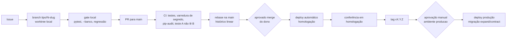

# Ambientes e entrega: local por feature, homologação e produção

Situação: **proposta em 05/11/2026, para lapidar**. Decisão e alternativas no [ADR 0024](../adr/0024-entregar-por-tres-ambientes-com-historico-linear-e-deploy-pelo-ci.md).

## Três ambientes

| | Local (por feature) | Homologação | Produção |
|---|---|---|---|
| Para quê | Desenvolver e testar uma issue | Ver a versão da `main` funcionando como em produção | Usuários reais |
| Onde | Worktree da issue + `docker compose` (Postgres/PostGIS, API, front em modo dev) | Mesma hospedagem da produção, projeto separado | Hospedagem paga mínima (fase 3) |
| Dados | Sintéticos ou organização `demonstracao` | Sintéticos ou `demonstracao`. **Nunca cópia da produção** | Reais |
| Quem acessa | Desenvolvedor e agentes de IA | Dono e testadores convidados | Usuários; dono só pelo painel do provedor, com MFA |
| Credenciais | Fixas e públicas (`agrovalid/agrovalid`) | Ambiente `homologacao` do GitHub | Ambiente `producao` do GitHub, com aprovação manual |
| Deploy | Manual, na máquina | Automático a cada merge na `main` | Por tag `vX.Y.Z`, com aprovação do dono |

**Local por feature.** Cada worktree sobe a própria pilha com um deslocamento de porta (por exemplo, `AGROVALID_PG_PORTA=5434 + N`), para duas issues rodarem em paralelo sem dividir banco. As migrações e o seed sintético rodam ao subir. É o que já acontece no gate de hoje, estendido à API e ao front.

## Fluxo de entrega

## Git

- **Histórico linear na `main`.** A branch é rebaseada sobre a `main` antes do merge (`git rebase origin/main`), e a proteção da `main` exige histórico linear. Nenhum commit de merge.
- **Squash por padrão:** um commit por issue na `main`, com `(#N)` no título, liga cada mudança à issue. **Rebase-merge** (sem squash) quando os commits da branch contam passos que valem a pena guardar separados.
- **`--force` nunca na `main`.** Depois de rebasear a própria branch de feature, o push usa `--force-with-lease`, só nela. Isso muda a regra atual ("nunca `--force`") e precisa do aceite do dono antes de valer.
- **Tags semânticas** marcam o que foi para produção; as notas da versão saem dos títulos dos commits.

## Migrações sem parar o sistema

Toda mudança de banco segue **expandir e depois contrair**: primeiro a versão que adiciona sem remover (coluna nova anulável, tabela nova), depois o código que usa, e só numa versão seguinte a remoção do que ficou velho. Assim, a versão anterior da API continua funcionando durante o deploy, e voltar atrás é trocar a imagem, não restaurar banco. As migrações continuam geradas dos contratos (ADR 0017).

## Hospedagem e custo

Valores de 11/2026, aproximados; conferir antes de contratar.

| Peça | Fase 1 (homologação) | Fase 3 (piloto) | Fase 4 (otimista) |
|---|---|---|---|
| Banco + identidade (Supabase, São Paulo) | Grátis: 500 MB, 50 mil usuários ativos/mês, pausa após 1 semana sem uso, sem backup | Pro: US$ 25/mês, 8 GB, 100 mil usuários ativos, backup diário | Pro + compute maior: US$ 25 + adicional |
| API (Cloud Run em São Paulo, ou Fly.io em `gru`) | Cota gratuita | US$ 0 a 10 | US$ 10 a 50 |
| Front (Cloudflare Pages) | Grátis | Grátis | Grátis |
| Borda (Cloudflare) | Grátis: 1 regra de limite, regras gerenciadas gratuitas, 5 regras próprias | Grátis | Pro: US$ 20/mês, 2 regras de limite, regras OWASP |
| Domínio `.com.br` | — | ≈ R$ 40/ano | ≈ R$ 40/ano |
| **Total** | **R$ 0** | **≈ US$ 30 a 40/mês** | **≈ US$ 80 a 150/mês** |

Fontes: [preços do Supabase](https://supabase.com/pricing); [WAF da Cloudflare](https://developers.cloudflare.com/waf/); [planos de WAF da Cloudflare comparados](https://icwt.cloud/en/blog/cloudflare-waf-plany-porownanie/); [Turnstile](https://tech-insider.org/cloudflare-turnstile-setup-2026/).

**Ponto de atenção:** o plano gratuito do Supabase permite dois projetos ativos. Homologação e produção cabem nele na fase 1, mas produção com usuário real precisa do Pro (backup e sem pausa).

## Observabilidade mínima

- Log estruturado em JSON com `request_id`, organização, rota, status e duração. Sem corpo, sem cookie, sem CPF.
- Verificação de disponibilidade a cada minuto na rota `/saude` (que testa o banco).
- Alerta para: taxa de erro 5xx, picos de 401/429 (sinal de ataque), falha de backup, execução do pipeline que não terminou.
- Restauração do backup testada uma vez por mês em homologação, a partir da fase 3.
