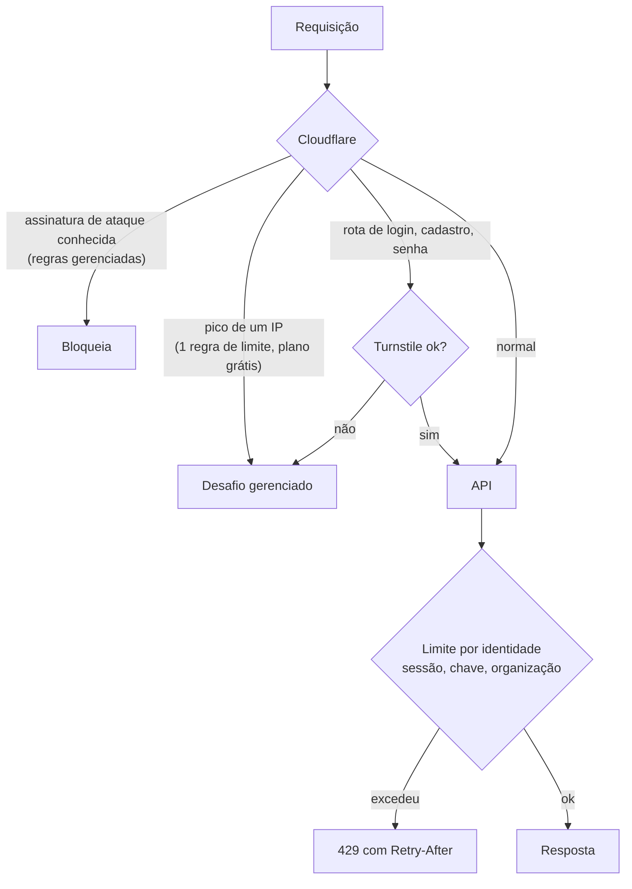

# Segurança: modelo de ameaças e controles

Situação: **proposta em 05/11/2026, para lapidar**. Referência de verificação: [OWASP ASVS 4.0](https://owasp.org/www-project-application-security-verification-standard/), nível 1 antes do piloto e nível 2 antes de várias cooperativas. Decisões em [ADR 0021](../adr/0021-autenticar-com-chave-por-organizacao-agora-e-provedor-de-identidade-com-bff-depois.md) (autenticação), [ADR 0023](../adr/0023-proteger-a-borda-com-cloudflare-e-limitar-por-identidade.md) (borda) e [ADR 0026](../adr/0026-limitar-o-que-agentes-de-ia-alcancam-no-desenvolvimento-e-no-produto.md) (agentes de IA).

## O que proteger

| Ativo | Por que importa |
|---|---|
| Cadastro da cooperativa (`cad.*`): produtores, imóveis atendidos, áreas de produção | Dado pessoal de terceiros; a cooperativa é a controladora (LGPD) |
| Resultado do pré-diagnóstico (`diag.*`) | Dado pessoal com risco de reputação e de crédito para o produtor |
| Chave do HMAC dos documentos (ADR 0002) | Com ela, o hash do CPF vira de novo CPF por força bruta |
| Credenciais: banco, provedor de identidade, Cloudflare, nuvem, GitHub | Dão acesso a tudo acima |
| Integridade das fontes e do lago | Uma fonte adulterada gera pendência falsa |

## Ameaças e controles

| Ameaça | Controle | Camada |
|---|---|---|
| Uma organização lê dados de outra | RLS no banco com `SET LOCAL app.organizacao_id` por transação; papel `agrovalid_leitura` sem `BYPASSRLS`; teste "A não lê B" em todo PR | Banco + API |
| Token roubado no navegador (XSS) | O navegador nunca recebe token: sessão em cookie `__Host-` `httpOnly`, `Secure`, `SameSite=Lax`; CSP estrita sem script inline; nenhum script de terceiro | Front + BFF |
| Requisição forjada (CSRF) | `SameSite=Lax` + token anti-CSRF em toda escrita + conferência de `Origin` | BFF |
| Chave de API vazada | Só o hash é guardado; prefixo identificável (para varredura de segredo); escopo só leitura; validade de 90 dias; revogação imediata; último uso registrado | API |
| Força bruta e enchimento de credenciais | Turnstile no login; atraso progressivo por conta (sem bloqueio fixo, que vira negação de serviço contra o usuário); MFA TOTP obrigatório para administrador da organização | Borda + provedor |
| Muitas requisições de um IP | Regra de limite da Cloudflare (grossa, por IP) | Borda |
| Ataque distribuído de muitos IPs | Limite por identidade (sessão, chave, organização), não por IP; desafio gerenciado em vez de bloqueio; respostas caras em cache; nenhuma rota anônima cara | Borda + API |
| Acesso direto à origem, pulando a Cloudflare | Origem sem IP público (túnel) ou só aceita o cabeçalho secreto da borda; o teste de implantação confere | Hospedagem |
| Injeção de SQL | Só consulta parametrizada (psycopg); nenhuma concatenação; papel sem escrita | API |
| Vazamento por erro ou log | Erro genérico para o cliente com `request_id`; log estruturado sem corpo de requisição, sem CPF, sem cookie | API |
| Dependência comprometida | Versões fixas no `requirements.txt` (regra 8 do repositório); Dependabot e `pip-audit` no CI; dependência nova só com o dono | Repositório |
| Segredo commitado | Proteção de push do GitHub e varredura de segredo no CI; `.env` só local | Repositório |
| Agente de IA com acesso demais (ver abaixo) | Agentes só no ambiente local com dado sintético; nenhuma credencial de homologação ou produção na máquina | Desenvolvimento |
| Fonte pública adulterada ou fora do ar | SHA-256 e data de cada arquivo baixado (já existe); dado incompleto vira "inconclusivo" (ADR 0013) | Pipeline |

## Borda e abuso

- **Limite em duas camadas.** A Cloudflare corta enxurrada de um IP. A API limita por quem está autenticado, o que pega o ataque distribuído (muitos IPs, mesma conta ou chave) sem bloquear quem divide IP, como a rede de uma cooperativa ou um celular em CGNAT.
- **Desafiar, não bloquear.** Diante de suspeita, a Cloudflare mostra um desafio gerenciado em vez de recusar: um técnico legítimo passa, um robô não.
- **Turnstile só onde há formulário anônimo:** login, cadastro, redefinição de senha, contato. É gratuito e não depende do proxy, mas envolve tratamento de dado pela Cloudflare (registrar na política de privacidade e no inventário LGPD).
- **Contador da API.** Na primeira instância, em memória do processo. Com mais de uma instância, numa tabela do Postgres (ou Redis gerenciado, se a medida mostrar necessidade).

## Tokens e segredos

| Segredo | Onde fica | Onde nunca fica |
|---|---|---|
| Chave de API da organização | Hash no banco; texto só uma vez, na criação, para o administrador | Navegador, log, URL, repositório |
| JWT do provedor de identidade | Memória do BFF durante a troca; depois, só a sessão no servidor | Navegador, `localStorage`, cookie legível por script |
| Chave do HMAC, senha do banco, segredo da borda | Cofre da nuvem ou ambiente protegido do GitHub, por ambiente | Máquina de desenvolvimento (fora o ambiente local), agentes de IA |
| Credencial de deploy | Nenhuma de longa duração: o GitHub Actions entra na nuvem por OIDC | Máquina do desenvolvedor |

## Agentes de IA (superfície multiagente)

O desenvolvimento usa várias sessões de agente em paralelo, com permissões amplas. Isso é uma superfície de ataque própria: injeção de instrução vinda de dado externo (PDF, site, texto de issue), segredo lido do disco e enviado para fora, comando destrutivo, ou um agente aprovando o trabalho de outro.

Regras ([ADR 0026](../adr/0026-limitar-o-que-agentes-de-ia-alcancam-no-desenvolvimento-e-no-produto.md)):
1. Agentes trabalham em worktree, contra o Postgres local, com dado sintético ou da organização `demonstracao`. Nunca têm credencial de homologação ou de produção.
2. Deploy só pelo CI. Nenhum agente roda comando de deploy nem fala com a nuvem.
3. Merge só com o "aprovado merge" do dono, dito na sessão do dono. Uma sessão não aceita aprovação repassada por outra (o fluxo atual já faz isso).
4. Texto vindo de fonte externa é dado, nunca instrução.
5. Servidor MCP ou ferramenta nova para agente passa pelo dono, como dependência nova.
6. Se o produto usar LLM no futuro: nenhum dado pessoal sai para o provedor sem contrato e sem pseudonimização; a saída do modelo nunca decide, só sugere ao técnico.
