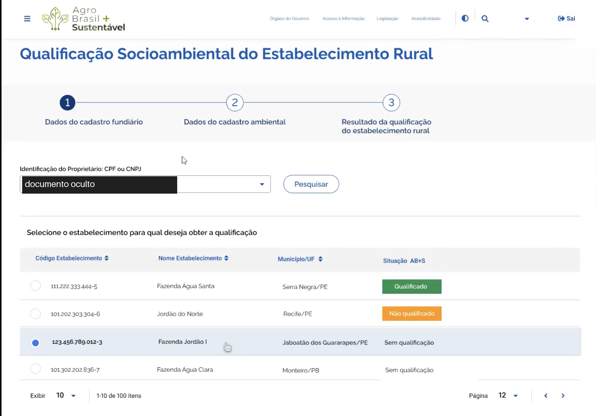
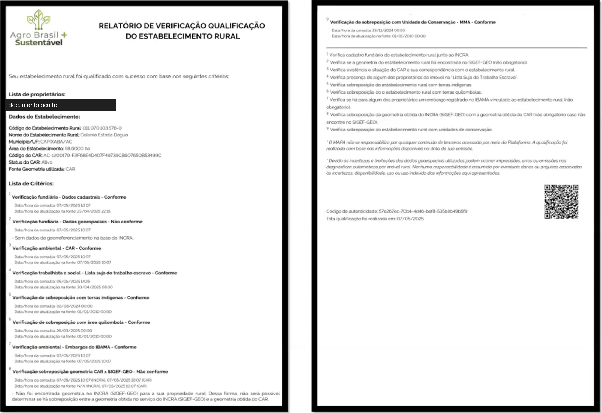
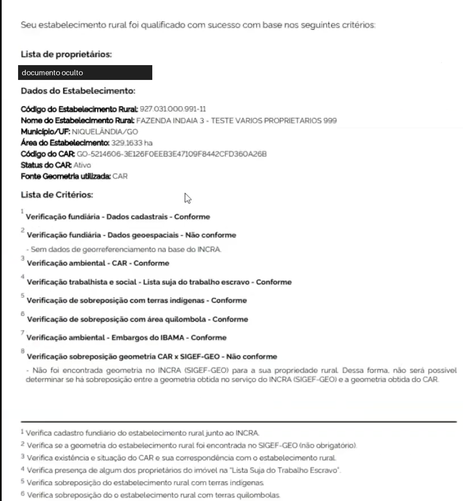
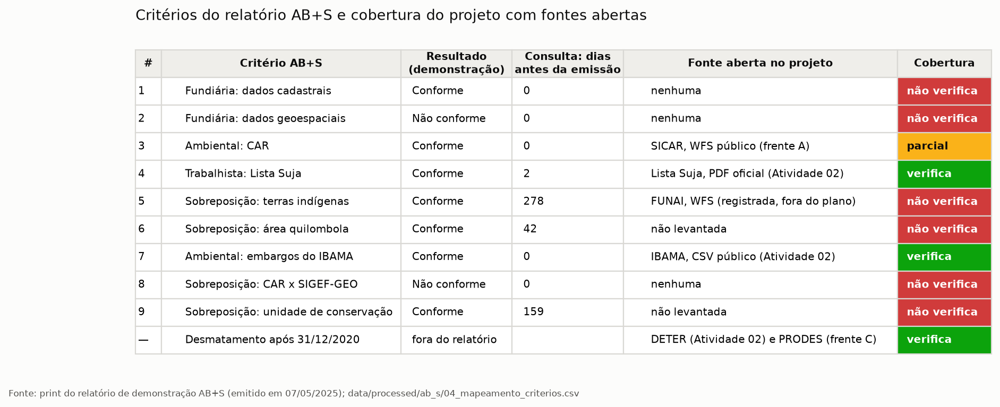
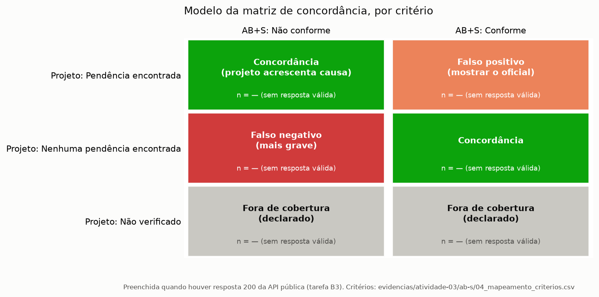

# Frente B — AB+S como referência pelo código de autenticidade

Testes de 13/10/2026. A consulta está em [`pipeline/fontes/ab_s.py`](../../pipeline/fontes/ab_s.py): valida o formato do código, consulta os três endpoints uma vez e grava cada resposta bruta em `data/raw/ab_s/<endpoint>/`, com o `.meta.json` e com CPF/CNPJ pseudonimizados antes de gravar. O caderno [`notebooks/02_fontes_antes_e_depois.ipynb`](../../notebooks/02_fontes_antes_e_depois.ipynb), seção 7, repete o código malformado, um UUID aleatório e a extração de um PDF sintético. As 9 consultas e o OCR descritos abaixo são do estudo de 13/10/2026, cujos scripts foram substituídos pelo módulo.

## 1. Conclusão

| Pergunta | Resposta | Evidência |
|---|---|---|
| A API pública de validação responde sem login? | Sim. Os 3 endpoints devolveram JSON nas 9 consultas | estudo de 13/10/2026; caderno, seção 7 |
| Já existe uma resposta válida (200)? | **Não.** Nenhum UUID real disponível; as 9 respostas são 404 ou 500 | estudo de 13/10/2026 |
| A API valida o formato do código? | Não. Um texto qualquer recebe o mesmo 404 de um UUID inexistente em 2 endpoints, e um erro interno (500) no terceiro | estudo de 13/10/2026 |
| O UUID sai do PDF? | Sim, pelo texto, com `pdfplumber`, quando o PDF tem camada de texto. Por OCR de um print, não: o melhor resultado acertou 29 de 36 caracteres | caderno, seção 7 (PDF); estudo de 13/10/2026 (OCR) |
| Quantos dos 9 critérios do relatório o projeto verifica com fonte aberta? | 2 inteiros (Lista Suja e embargos do IBAMA) e 1 parcial (CAR). Ficam 6 sem verificação, 4 deles obrigatórios | `ab_s.CRITERIOS`; caderno, seção 7 |
| O canal público serve para acompanhar uma carteira? | Não. Valida um relatório por vez e depende de o produtor emiti-lo (seção 7) | — |

O AB+S entra no projeto como **referência pontual**: confirma um relatório que o produtor apresenta e é exibido ao lado do pré-diagnóstico. Não substitui o pré-diagnóstico em carteira e não é recriado por ele.

## 2. Os prints do relatório

Os prints da sessão de demonstração mostram a estrutura do relatório. CPF e CNPJ foram ocultados nas figuras antes de entrarem no repositório.

| Print | O que mostra |
|---|---|
|  | Busca pelo documento do proprietário. A coluna "Situação AB+S" já antecipa o resultado (Qualificado, Não qualificado, Sem qualificação) e a lista tem 100 itens |
|  | Relatório emitido em 07/05/2025: 9 critérios com resultado, data da consulta e data de atualização na fonte; QR e código de autenticidade no rodapé |
|  | Outro relatório, de um estabelecimento chamado "FAZENDA INDAIA 3 - TESTE VARIOS PROPRIETARIOS 999" |

O que os prints comprovam, com o próprio relatório como fonte:

- **O resultado não explica a causa nem o caminho.** Os critérios 2 e 8 aparecem como "Não conforme" porque o INCRA não tem a geometria do imóvel ("Sem dados de georreferenciamento na base do INCRA"). O mesmo rótulo serve para falta de dado na fonte e para irregularidade, e nenhum critério traz o que fazer para regularizar.
- **"Não conforme" não impede a qualificação.** Os dois relatórios dizem "Seu estabelecimento rural foi qualificado com sucesso" com dois critérios não conformes, porque ambos são marcados como não obrigatórios.
- **Datas de atualização de valor fixo.** Os critérios 5, 6 e 9 (terras indígenas, quilombolas e unidades de conservação) informam atualização na fonte em 01/01/2010 00:00, e a consulta de terras indígenas é de 02/08/2024, 278 dias antes da emissão.
- **Ambiente de teste.** O nome "TESTE VARIOS PROPRIETARIOS 999" indica que a sessão foi feita em ambiente de teste. O UUID impresso no relatório de demonstração (`57e267ec-70b4-4d46-bef8-535b8b49b5f9`) não existe na API de produção (seção 3).

## 3. API pública de validação (B1)

Três casos por endpoint, uma requisição cada, com pausa de 2 s e o User-Agent do projeto: um UUID aleatório gerado na hora (inexistente por construção), o UUID do relatório de demonstração e o texto `nao-e-um-uuid`.

| Endpoint | UUID aleatório | UUID da demonstração | Texto que não é UUID |
|---|---|---|---|
| `GET /abs/backend/api/public/qualificacao/{codigo}` | 404 "Não foi encontrado nenhum registro na entidade Validacao" | 404, mesma mensagem | 404, mesma mensagem |
| `GET /abs/backend/api/public/habilitacao/{codigo}` | 404, entidade `ValidacaoPlanoSafra`, campo `COD_AUTENTICACAO` | 404, mesma mensagem | **500** "Can't find resource for bundle java.util.PropertyResourceBundle, key COD_AUTENTICACAO" |
| `GET /abs/backend/api/public/area-producao/{codigo}` | 404 "Não foi encontrada área de produção para o código informado." | 404, mesma mensagem | 404, mesma mensagem |

Todas as respostas têm o mesmo envelope JSON: `timestamp`, `status`, `title`, `message`. As respostas do estudo não são mantidas no repositório; o módulo grava cada nova consulta com o SHA-256 no `.meta.json`.

Consequências para o projeto:

1. **Validar o formato antes de consultar.** A API não distingue "código inexistente" de "código malformado", então um erro de digitação ou de OCR seria registrado como "relatório não encontrado". O projeto aceita só 36 caracteres no padrão 8-4-4-4-12 hexadecimal (função `validar_uuid` em `pipeline/fontes/ab_s.py`, validação `ABS_UUID_FORMATO_INVALIDO`, que interrompe antes de qualquer requisição).
2. **Tratar 500 como falha do serviço, nunca como resultado.** O 500 do endpoint `habilitacao` é um erro interno de tradução de mensagem, não uma resposta sobre o relatório (`ab_s.interpretar` e validação `ABS_ERRO_SERVICO`).
3. **O 404 não prova que o relatório é falso.** Pode ser código errado, relatório de ambiente de teste (como o da demonstração) ou mudança da API, que não é documentada. O texto exibido é "não localizado na consulta pública em [data]" (validação `ABS_NAO_LOCALIZADO`).

## 4. Resposta válida (B3): pendente

Não há relatório AB+S real disponível. Por isso não existe resposta 200 nem a estrutura dos campos, e a matriz de concordância (seção 6) fica sem dados. O motivo é externo: o relatório só é emitido pelo titular do imóvel, com login gov.br e imóvel no SNCR.

Revisão do que o plano prevê para esta tarefa:

| Ponto | Situação | Observação |
|---|---|---|
| Opção "produtor voluntário" | Não iniciada | Exige consentimento por escrito, porque o UUID dá acesso ao resultado do produtor |
| Opção "relatório publicado" | Não iniciada | Só vale se a divulgação for do próprio titular; não se procura UUID por varredura |
| Opção "conta gov.br própria" | Não testada | Só funciona com imóvel vinculado ao CPF no SNCR; o plano avalia que provavelmente não se aplica |
| O que o QR codifica | Não testado | Não há leitor de QR no ambiente do projeto (`opencv` ou `pyzbar`). A hipótese é a página `validar-qualificacao/{uuid}`, que usa a mesma API |
| Pseudonimização da resposta | Implementada sem resposta real para testar | `ab_s.pseudonimizar_resposta` troca CPF/CNPJ pelo HMAC de `pipeline/documentos.py` em qualquer campo do JSON antes de gravar; testada com resposta sintética |

**Situação em 30/10/2026:** continua pendente. O pré-diagnóstico da Atividade 04 já usa `ab_s.CRITERIOS` para exibir os 6 critérios sem fonte aberta como "não verificado", mas ainda não recebe o PDF do relatório nem mostra o resultado oficial ao lado. O que falta obter e as opções estão em [`../atividade-04-prediagnostico.md`](../atividade-04-prediagnostico.md), seções 4 e 6.

Quando houver um UUID real, o procedimento é `ab_s.consultar(uuid, chave)`: valida o formato, consulta uma vez cada endpoint e grava a resposta pseudonimizada em `data/raw/ab_s/`. Falta documentar a resposta campo a campo.

## 5. Extração do código de autenticidade (B2)

| Caminho | Entrada | Resultado |
|---|---|---|
| Texto do PDF (`pdfplumber`) | PDF sintético com o rodapé do relatório | UUID correto, `57e267ec-70b4-4d46-bef8-535b8b49b5f9` |
| Texto do PDF (`pdfplumber`) | PDF sintético sem o rodapé | Nenhum UUID, como esperado |
| OCR (`tesseract` 5.5.2) | Print do relatório, página inteira | Nada lido |
| OCR (`tesseract` 5.5.2) | Print, recorte do rodapé ampliado 2 a 6 vezes | Melhor caso: 29 de 36 caracteres certos (`57e267ec-70m4-4d46-bef8-538b8pt9bhe`). Nenhum UUID válido |
| QR code | Print do relatório | Não testado: sem decodificador no ambiente |

Sem um PDF real, o caminho por texto (`ab_s.extrair_uuid`) é testado com um PDF sintético, gerado no caderno e em `tests/test_ab_s.py`. O relatório tem o código em texto ("Código de autenticidade: ..."), então o caminho deve funcionar no PDF original, desde que ele não seja uma digitalização. O OCR de print não é confiável: o código tem 32 dígitos hexadecimais sem redundância, e um caractere errado leva a outro UUID. Print ou foto do relatório não entra como evidência de autenticidade; o projeto pede o PDF.

## 6. Critério do AB+S e critério do projeto (B4)

| # | Critério do relatório | Obrigatório | Código interno do AB+S | Fonte aberta no projeto | Cobertura |
|---|---|---|---|---|---|
| 1 | Fundiária: dados cadastrais | sim | `VERIFICACAO_DADOS_CADASTRAIS` | nenhuma (SNCR sem consulta aberta por imóvel) | não verifica |
| 2 | Fundiária: dados geoespaciais | não | `VERIFICACAO_DADOS_GEO` | nenhuma (SIGEF exige login gov.br) | não verifica |
| 3 | Ambiental: CAR | sim | `VERIFICACAO_CAR` | SICAR, WFS público (`pipeline/fontes/sicar.py`) | parcial: existência e status; o vínculo CAR–SNCR não |
| 4 | Trabalhista: Lista Suja | sim | `VERIFICACAO_TRABALHO_ESCRAVO` | Lista Suja, PDF oficial (Atividade 02) | verifica, se houver o documento de cada proprietário |
| 5 | Sobreposição: terras indígenas | sim | `VERIFICACAO_SOBREPOSICAO_INDIGENA` | FUNAI, WFS (registrada, fora do plano) | não verifica |
| 6 | Sobreposição: área quilombola | sim | `VERIFICACAO_SOBREPOSICAO_QUILOMBOLA` | não levantada | não verifica |
| 7 | Ambiental: embargos do IBAMA | não | `VERIFICACAO_EMBARGOS_IBAMA` | IBAMA, CSV público (Atividade 02) | verifica |
| 8 | Sobreposição: CAR x SIGEF-GEO | não | `VERIFICACAO_SOBREPOSICAO_GEO_CAR` | nenhuma (depende do 2) | não verifica |
| 9 | Sobreposição: unidade de conservação | sim | `VERIFICACAO_SOBREPOSICAO_UNIDADE_CONSERVACAO` | não levantada | não verifica |
| — | Desmatamento após 31/12/2020 | — | `VERIFICACAO_SOBREPOSICAO_PRODES` | DETER (Atividade 02) e PRODES (`pipeline/fontes/inpe_prodes.py`) | verifica |

A tabela está em `ab_s.CRITERIOS`. A correspondência entre número do critério e código interno foi feita pelo nome, a partir da taxonomia levantada no código público do site. Ela só fica confirmada com uma resposta 200 (seção 4). O desmatamento não está entre os 9 critérios da qualificação: no AB+S ele entra na habilitação da área de produção, que é outro endpoint (`area-producao`). Por isso a comparação do PRODES é com esse endpoint.

Os 6 critérios sem verificação são exibidos no relatório do projeto como **"não verificado"**, nunca como "sem pendência". Esse é o principal controle contra falso negativo.

## 7. Validação cruzada

Quando houver resultado oficial, cada critério é classificado assim:

| Projeto | AB+S | Classificação | O que o projeto faz |
|---|---|---|---|
| Pendência encontrada | Não conforme | Concordância | Acrescenta a causa e o caminho de regularização |
| Nenhuma pendência encontrada | Conforme | Concordância | — |
| Pendência encontrada | Conforme | Falso positivo | Mostra o oficial em destaque e revisa a regra |
| Nenhuma pendência encontrada | Não conforme | Falso negativo | Mais grave: critério sem fonte aberta ou fonte desatualizada |
| Não verificado | Qualquer | Fora de cobertura | Declara no relatório |

Dois casos dos prints entram como regra desde já: "Não conforme" por falta de dado no INCRA (critérios 2 e 8) não é pendência do produtor e é classificado à parte; e um critério não obrigatório não conforme não muda a qualificação.

Com a cobertura atual, o melhor caso possível em um relatório é comparar 3 dos 9 critérios. A matriz é preenchida por critério e só tem sentido com uma amostra de relatórios reais; com um único relatório, ela serve para conferir o mapeamento, não para medir qualidade.

## 8. Viabilidade para o técnico (B5)

| Necessidade do técnico | Canal público (UUID) | API Serpro (produção) | Pré-diagnóstico do projeto |
|---|---|---|---|
| Carteira inteira | Não. Um relatório por vez | Sim, em lote | Sim |
| Periodicidade | Não. Vale a data de emissão, sem aviso quando algo muda | Sim, por nova consulta | Sim, a cada execução do pipeline |
| Iniciativa | Do produtor, que precisa emitir e entregar o PDF | Do operador financeiro | Do técnico |
| Acesso | Livre, sem login | Contrato; só operadores autorizados pelo Banco Central | Livre |
| Critérios | Os 9, com resultado oficial | Os 9, com resultado oficial | 2 inteiros e 1 parcial, mais desmatamento |
| Valor jurídico | Oficial | Oficial | Indício com fonte e data |

**Conclusão:** o canal público não serve para acompanhar uma carteira. Ele serve para conferir, em um imóvel específico, um relatório que o produtor já emitiu, e para medir a qualidade do pré-diagnóstico do projeto. O acompanhamento periódico da carteira continua sendo feito pelo projeto com fontes abertas. O resultado oficial em lote só existiria com a API Serpro, que é fonte de produção.

## 9. Regras de uso

Decisão registrada no [ADR 0008](../arquitetura/adr/0008-usar-o-ab-s-como-referencia-sem-declarar-conformidade.md).

- O projeto nunca afirma conformidade. Usa "pendência encontrada nas bases consultadas em [data]" e "nenhuma pendência encontrada nas bases consultadas em [data]".
- O resultado do AB+S aparece citado, com fonte, data da consulta, UUID e SHA-256 da resposta. Não é reescrito.
- Uma consulta por relatório, sob demanda, com User-Agent identificado. Sem varredura de UUIDs.
- Só o necessário da resposta é guardado. Documento de pessoa é pseudonimizado.
- Texto fixo no relatório do projeto: "Este é um pré-diagnóstico com base em fontes públicas. Não é atestado, certificação nem parecer jurídico. A qualificação oficial é a do AgroBrasil+Sustentável (MAPA)."

## 10. Conferência das evidências

Conferência do estudo de 13/10/2026: 15 verificações, todas ok. No módulo, as verificações de formato, JSON e status viraram as validações `ABS_*` do `ResultadoFonte`, e as de extração e de mapeamento viraram testes em `tests/test_ab_s.py`.

| Verificação | Verificados | Ocorrências |
|---|---|---|
| Respostas recebidas = consultas planejadas | 9 | 9 |
| Chave (endpoint, caso) duplicada | 9 | 0 |
| SHA-256 do arquivo diferente do registrado | 9 | 0 |
| `.meta.json` sem data da consulta | 9 | 0 |
| Corpo que não é JSON | 9 | 0 |
| Status fora de {404, 500} | 9 | 0 |
| Status 200 | 9 | 0 |
| Casos de PDF com resultado diferente do esperado | 2 | 0 |
| Tentativas de OCR que produziram UUID válido | 6 | 0 |
| Validação de formato com resultado inesperado | 6 | 0 |
| Critérios do relatório mapeados | 9 | 9 |
| Número de critério duplicado | 9 | 0 |
| Cobertura fora do domínio | 10 | 0 |
| Critério sem código interno | 10 | 0 |
| Arquivo de evidência com padrão de CPF ou CNPJ | 25 | 0 |

Não há geometria, CRS nem série de datas nesta frente; as datas dos critérios foram transcritas do print do relatório de demonstração.

## 11. Tarefas

| # | Tarefa | Situação | Saída |
|---|---|---|---|
| B1 | Repetir os testes da API pública | Concluída | `ab_s.consultar`; caderno, seção 7 |
| B2 | Extrair o UUID do PDF e validar o formato | Concluída com PDF sintético; OCR testado e descartado; QR não testado | `ab_s.extrair_uuid`, `ab_s.validar_uuid`; caderno, seção 7 |
| B3 | Conseguir um UUID real e guardar a resposta válida | **Pendente**: sem relatório real (seção 4) | — |
| B4 | Mapear critério AB+S → critério do projeto | Concluída; correspondência dos códigos internos a confirmar com B3 | `ab_s.CRITERIOS`, seção 6 |
| B5 | Viabilidade para o técnico | Concluída | Seção 8 |
| B6 | ADR da regra de referência | Concluída | ADR 0008 |

## Fechamento

- **Código:** `pipeline/fontes/ab_s.py` (`validar_uuid`, `extrair_uuid`, `interpretar`, `pseudonimizar_resposta`, `consultar` e a tabela `CRITERIOS`), com `config.URL_AB_S_PUBLICO` e `config.AB_S_ENDPOINTS`.
- **Testes:** `tests/test_ab_s.py` (formato do código, 404 e 500, extração de PDF sintético com e sem código, pseudonimização e código malformado que não chega à rede).
- **Documentos:** seção do AB+S em [`inconsistencias-dos-dados.md`](../inconsistencias-dos-dados.md) e componente sob demanda em [`arquitetura.md`](../arquitetura/arquitetura.md).
