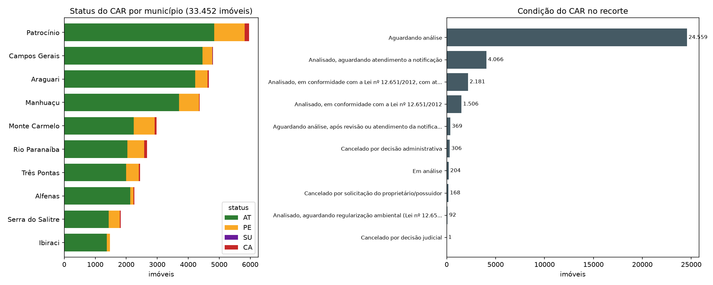
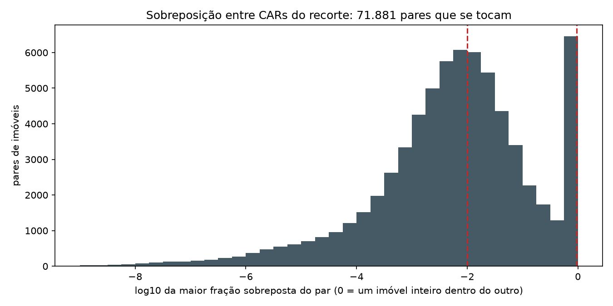
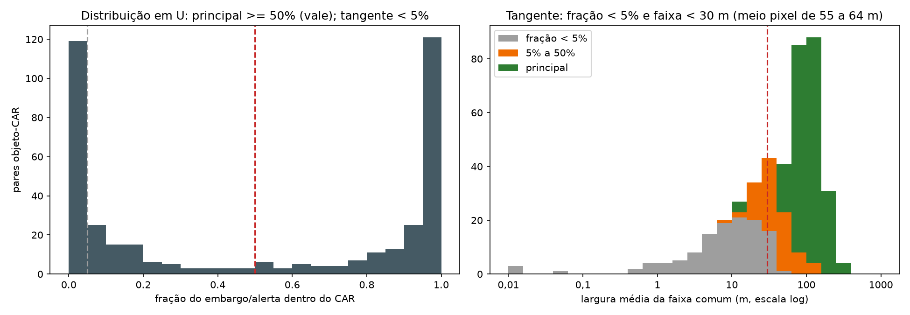
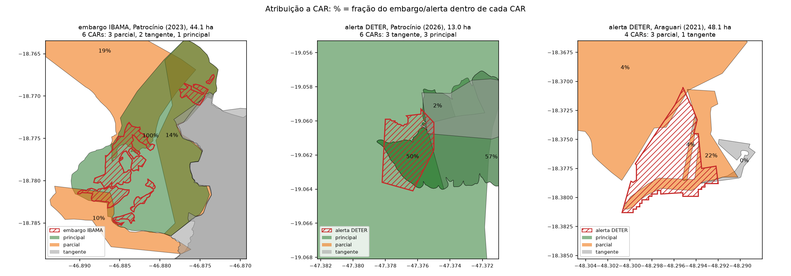
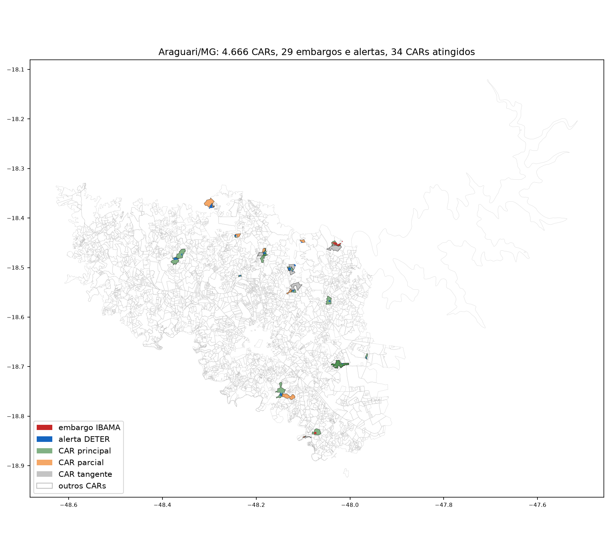

# Frente A — CAR pelo WFS público do SICAR

Obter o polígono e a situação do CAR com fonte aberta, medir as inconsistências e definir a regra que atribui um embargo ou alerta a um CAR. Consultas feitas em 13/10/2026. O acesso e as validações estão em [`pipeline/fontes/sicar.py`](../../pipeline/fontes/sicar.py) e a regra de atribuição em [`pipeline/cruzamento.py`](../../pipeline/cruzamento.py). O SICAR é consultado sob demanda, e cada resposta bruta fica em `data/raw/sicar/<uf>/` com o `.meta.json`. Os números citados como "caderno, seção N" são reproduzidos pelo caderno [`notebooks/02_fontes_antes_e_depois.ipynb`](../../notebooks/02_fontes_antes_e_depois.ipynb). Os citados como "estudo de 13/10/2026" vêm das consultas exploratórias daquela data, cujos scripts foram substituídos pelos módulos e não são repetidos no caderno. Decisão registrada na [ADR 0007](../arquitetura/adr/0007-obter-o-car-pelo-wfs-publico-do-sicar.md).

## Resultado em uma tabela

| Pergunta | Resposta | Evidência |
|---|---|---|
| O WFS do SICAR entrega o CAR completo de um município? | Sim. 10 municípios, 33.452 imóveis, anunciado = recebido em todos | caderno, seção 5 |
| O dado é limpo? | Quase. Sem código repetido, sem geometria nula, sem CRS inesperado. 13 geometrias inválidas, 54 códigos com município diferente do declarado e **20% dos imóveis com 95% ou mais da área coberta por outro CAR** | caderno, seção 5 |
| Um embargo ou alerta cai em um CAR só? | Em 128 de 179 casos há exatamente um CAR principal. Em 44 há mais de um, por CARs sobrepostos. 3 não caem em nenhum CAR | caderno, seção 8 |
| A situação `AT` garante que não há sobreposição? | Não. Dos 6.727 imóveis quase inteiramente sobrepostos, 5.537 estão `AT`, 5.471 deles ainda "Aguardando análise" | caderno, seção 5 |
| Quanto custa achar o CAR? | 0,30 s pelo código, 0,27 s por ponto, 0,36 s por polígono (medianas) | estudo de 13/10/2026 |

## A0. Recorte: os 10 maiores produtores de café de MG

O plano fixa café em MG. Para não escolher município a dedo, o recorte é o dos 10 maiores produtores na Produção Agrícola Municipal (PAM/IBGE, tabela 1613, café em grão, 2025), consultada pela API do SIDRA. Os três municípios testados no plano (Patrocínio, Manhuaçu e Três Pontas) estão entre eles. Os 10 somam 17,1% do café de MG; 484 dos 852 municípios de MG na PAM produzem café.

| # | Município | Café 2025 (t) | | # | Município | Café 2025 (t) |
|---:|---|---:|---|---:|---|---:|
| 1 | Patrocínio | 48.669 | | 6 | Três Pontas | 24.898 |
| 2 | Manhuaçu | 29.040 | | 7 | Serra do Salitre | 24.270 |
| 3 | Monte Carmelo | 27.938 | | 8 | Araguari | 22.495 |
| 4 | Ibiraci | 26.352 | | 9 | Alfenas | 21.174 |
| 5 | Campos Gerais | 25.068 | | 10 | Rio Paranaíba | 17.434 |

Fonte: API do SIDRA, estudo de 13/10/2026. Os códigos dos 10 municípios ficam em `config.MUNICIPIOS_CAFE_MG`.

## A1. Coleta por município

Uma requisição por município (`cod_municipio_ibge=<código>`), no mesmo padrão da partição mensal do DETER ([ADR 0004](../arquitetura/adr/0004-coletar-alertas-deter-em-particoes-mensais-e-identificar-pelo-conteudo.md)): antes, um pedido `resultType=hits` com o total anunciado; depois, o GeoJSON completo, conferindo `numberMatched` e o número de feições recebidas.

| Município | Anunciado | Recebido | Tempo (s) | MB |
|---|---:|---:|---:|---:|
| Patrocínio | 5.962 | 5.962 | 5,9 | 13,8 |
| Manhuaçu | 4.370 | 4.370 | 2,0 | 6,5 |
| Monte Carmelo | 2.977 | 2.977 | 3,0 | 5,9 |
| Ibiraci | 1.479 | 1.479 | 2,6 | 3,0 |
| Campos Gerais | 4.796 | 4.796 | 2,2 | 5,4 |
| Três Pontas | 2.449 | 2.449 | 2,7 | 4,4 |
| Serra do Salitre | 1.826 | 1.826 | 1,8 | 5,3 |
| Araguari | 4.666 | 4.666 | 3,2 | 10,8 |
| Alfenas | 2.260 | 2.260 | 1,4 | 3,4 |
| Rio Paranaíba | 2.667 | 2.667 | 2,0 | 6,3 |
| **Total** | **33.452** | **33.452** | **26,7** | **64,8** |

Fonte: anunciado e recebido, caderno, seção 5 (`ResultadoFonte.entrada["requisicoes"]`); tempo e tamanho, estudo de 13/10/2026. As respostas completas ficam em `data/raw/sicar/mg/`, fora do Git, com o SHA-256 no `.meta.json` de cada uma. O CRS de todas as respostas é `EPSG:4674` (SIRGAS 2000), o mesmo do DETER e do IBAMA (validação `CAR_CRS_INESPERADO`).

**Acesso.** Com a configuração padrão, o `requests` do Python não completa o *handshake* com o servidor (plano, seção 5). O módulo monta na sessão um adaptador com cifras de nível 1 (`DEFAULT:@SECLEVEL=1`) e renegociação legada (`OP_LEGACY_SERVER_CONNECT`), com a verificação do certificado ligada; o teste `test_adaptador_tls_mantem_verificacao_do_certificado` confere isso.

## A2. Inconsistências do CAR

Validações de `sicar.transformar`, registradas com `ResultadoFonte` de `pipeline/validacao.py`, como nas fontes da Atividade 2. Valem para as três formas de consulta (município, retângulo e ponto). Na consulta por município, a posição do imóvel é conferida contra a malha municipal do IBGE (API de malhas, qualidade máxima).

| Código | Inconsistência | Severidade | Ocorrências (de 33.452) | Tratamento |
|---|---|---|---:|---|
| `CAR_PARTICAO_INCOMPLETA` | Recebido diferente do `numberMatched` anunciado | erro | 0 de 10 requisições | Interrompe a consulta; repetir |
| `CAR_CRS_INESPERADO` | CRS diferente de EPSG:4674 | erro | 0 de 10 requisições | Interrompe a consulta |
| `CAR_CODIGO_INVALIDO` | Código fora de `UF-IBGE-32 hex` | descarte | 0 | Vai para descartados |
| `CAR_DUPLICADO` | `cod_imovel` repetido | descarte | 0 | Vai para descartados |
| `CAR_STATUS_DESCONHECIDO` | Status fora de `AT`, `PE`, `SU`, `CA` | descarte | 0 | Vai para descartados |
| `CAR_GEOM_AUSENTE` | Sem geometria | descarte | 0 | Vai para descartados |
| `CAR_GEOM_INVALIDA` | Autointerseção | correção | 13 (0,04%) | `make_valid` antes de medir |
| `CAR_PREFIXO_MUNICIPIO_DIVERGENTE` | Município no código do CAR diferente de `cod_municipio_ibge` | alerta | 54 (0,16%) | Manter `cod_municipio_ibge`; cruzar sempre pela geometria |
| `CAR_FORA_DO_MUNICIPIO` | Ponto interno do imóvel fora do município declarado | alerta | 298 (0,89%) | Manter; município pela geometria quando preciso |
| `CAR_AREA_DIVERGENTE` | Área declarada difere mais de 1% da área da geometria | alerta | 24 (0,07%) | Usar a área da geometria nas frações |
| `CAR_CANCELADO` | Status `CA` | alerta | 476 (1,42%) | Manter, mas não usar como CAR do imóvel |
| `CAR_SOBREPOSTO_95` | 95% ou mais da área coberta por outros CARs da consulta | alerta | **6.727 (20,11%)** | Marcar; a atribuição lista todos os CARs atingidos |

Fonte: caderno, seção 5. A área da geometria é medida numa projeção senoidal (igual-área) centrada em −45°. O viés constante dessa projeção é descontado antes de aplicar o limite de 1%: a razão área declarada / área medida é comparada com a sua mediana.

O estudo de 13/10/2026 mediu também campos que não viraram validação do módulo, por não afetarem o cruzamento: `m_fiscal` = 0 com área positiva (39 imóveis), `m_fiscal` diferente de `area / módulo` do município (233), `data_atualizacao` ausente (547) e atualização anterior à criação (6). Área zero, criação antes de 05/05/2014, tipo fora de `IRU`/`AST`/`PCT` e condição vazia: nenhum caso.

Status: `AT` 28.428, `PE` 4.539, `CA` 476, `SU` 9. A condição mais comum é "Aguardando análise": 24.559 imóveis, 73% do recorte (caderno, seção 5).

### Sobreposição entre CARs

O cadastro é autodeclarado e o SICAR aceita perímetros sobrepostos. Entre os 33.452 imóveis há 71.881 pares que se tocam:

| Maior fração sobreposta do par | Pares | Pares com os dois `AT` ou `PE` |
|---|---:|---:|
| Só borda (área 0) | 2.789 | 2.695 |
| Menos de 1% | 37.772 | 36.999 |
| 1% a 10% | 19.202 | 18.929 |
| 10% a 95% | 7.764 | 7.583 |
| 95% ou mais (um contém o outro) | 4.354 | 4.023 |

Fonte: estudo de 13/10/2026.

O pico entre 0,1% e 1% é de vizinhos cujos desenhos não coincidem na divisa. O pico no fim da escala é de imóveis contidos em outro: dois cadastros para a mesma área, com código e status próprios. Pela IN MMA nº 2/2014 (art. 51, II, e), sobreposição de perímetro com outro imóvel deixa o CAR **pendente**. Nos dados isso não aparece: dos 6.727 imóveis com 95% ou mais da área coberta por outros CARs, 5.537 estão `AT`, e 5.471 desses ainda "Aguardando análise" (caderno, seção 5, com o mapa de um exemplo). O status `AT` diz que a inscrição foi feita, não que a sobreposição foi conferida. Para o projeto, `AT` sozinho não basta como sinal de regularidade.

## A3. Regra de atribuição embargo/alerta → CAR

**Objetos.** Os 16 embargos IBAMA com geometria (15 posteriores a 2020) e os 163 alertas DETER de desmatamento nos 10 municípios, como saíram do pipeline da Atividade 2. **Consulta.** Uma consulta `BBOX` por objeto ao WFS, sem filtro de município. A interseção é calculada localmente. Para cada par (objeto, CAR):

- `fracao_objeto` = interseção / área do objeto: quanto do embargo ou alerta cai no CAR;
- `fracao_car` = interseção / área do CAR: quanto do CAR é atingido;
- `largura_m` = 2 × área / perímetro da interseção: largura média da faixa comum.

**Limiares, tirados dos dados.**

- A distribuição de `fracao_objeto` tem forma de U: 119 pares abaixo de 5%, 140 com 95% ou mais e só 39 entre 25% e 75% (painel da esquerda). **Principal**: `fracao_objeto` >= 50%, no meio do vale. Mover o corte de 30% para 70% muda o número de principais de 230 para 200 (estudo de 13/10/2026).
- **Tangente**: `fracao_objeto` < 5% (o primeiro intervalo do U) **e** faixa comum com menos de 30 m de largura média. Os 163 alertas do recorte vêm das câmeras de campo largo do Amazonia-1 (101), do CBERS-4 (40) e do CBERS-4A (22) (estudo de 13/10/2026, coluna `satelite` dos alertas). Segundo o INPE, o pixel é de 64 m no CBERS-4 e no Amazonia-1 e de 55 m no CBERS-4A ([CBERS-4](https://www.gov.br/inpe/pt-br/programas/cbers/sobre-o-cbers-1/cbers-3-e-4/cameras-imageadoras), [CBERS-4A](https://www.gov.br/inpe/pt-br/programas/cbers/sobre-o-cbers-1/cbers-04a/cameras-imageadoras), [Amazonia-1](https://data.inpe.br/dados/), consultados em 13/10/2026). Uma faixa mais estreita que meio pixel não é resolvida pelo sensor e indica divisa mal desenhada, não supressão dentro do CAR. As duas condições juntas evitam que um objeto estreito, mas inteiro dentro do CAR, vire tangente.
- **Parcial**: o resto. O CAR é atingido de verdade, mas não contém a maior parte do objeto.

O limiar de largura é o mais sensível: entre 15 m e 60 m, os tangentes vão de 78 a 119 pares (estudo de 13/10/2026). Para os embargos do IBAMA, a resolução de origem não é conhecida, e o mesmo limiar é aplicado por falta de informação melhor.

**Resultado.** 415 pares: 218 principais, 85 parciais e 112 tangentes (caderno, seção 8).

| Situação do objeto | Alertas DETER | Embargos IBAMA | Total |
|---|---:|---:|---:|
| Um CAR principal | 114 | 14 | 128 |
| Mais de um CAR principal (CARs sobrepostos) | 43 | 1 | 44 |
| Só parciais | 3 | 0 | 3 |
| Só tangentes | 1 | 0 | 1 |
| Sem CAR localizado | 2 | 1 | 3 |
| **Total** | **163** | **16** | **179** |

Fonte: caderno, seção 8 (`cruzamento.atribuir_car`). Cada objeto toca de 0 a 7 CARs (mediana 2; estudo de 13/10/2026). Descontados os tangentes, 82 objetos ficam com um CAR só e 93 com dois a cinco. No teste do plano com 30 embargos do Acre, a mediana era 3 e o máximo 19, sem descontar os tangentes.

1. **Embargo em Patrocínio (2023, 44,1 ha):** um CAR principal com 100% do embargo, três parciais (19%, 14% e 10%) e dois tangentes na divisa. Um dos parciais tem 98% da sua área dentro do principal: é outro cadastro sobre o mesmo imóvel. Os dois tangentes também são cadastros da mesma área (um cobre 93% do outro).
2. **Alerta em Patrocínio (2026, 13,0 ha):** três CARs principais. Um é muito grande e contém o alerta inteiro (o alerta ocupa 0,02% dele); os outros dois, com 50% e 57% do alerta, estão dentro dele. Sem a regra, o alerta seria atribuído a seis CARs; com ela, a três, todos sobre a área. Os outros três tocam a borda.
3. **Alerta em Araguari (2021, 48,1 ha):** três parciais que somam 30% do alerta e um tangente; o resto não está em nenhum CAR. Um dos parciais é um CAR pequeno que está inteiro dentro do alerta (`fracao_car` = 100%): pela ótica do alerta é parcial, pela ótica do imóvel é atingido por inteiro. Por isso a regra guarda as duas frações.

O caso 1 é redesenhado no caderno, seção 8, a partir das consultas do módulo.

**Por que consultar por objeto, e não só pelo município.** Em 7 objetos, um dos CARs atingidos (5 deles principais) está registrado em outro município e não aparece na coleta municipal da A1 (estudo de 13/10/2026). Atribuir só com os CARs do município do embargo perderia esses casos.

**Como ler "sem CAR localizado".** São 3 objetos, entre eles um embargo de 3,6 ha em Araguari (2021). Pode ser imóvel sem CAR, CAR desenhado fora do lugar ou embargo fora de área rural. O projeto registra "sem CAR localizado", nunca "sem CAR" (plano, seção 5, degrau 5).

## A4. Significado dos códigos

| Campo | Valor | Significado | Fonte | Classificação |
|---|---|---|---|---|
| `status_imovel` | `AT` | Ativo: inscrição concluída; ou cumprindo atualizações; ou analisado e regular em APP, uso restrito e RL | IN MMA nº 2/2014, art. 51, I; catálogo Conecta | Oficial |
| `status_imovel` | `PE` | Pendente: notificação de irregularidade; sobreposição com TI, UC, área embargada ou outro imóvel; declaração incorreta; diligência não cumprida | IN MMA nº 2/2014, art. 51, II; catálogo Conecta | Oficial |
| `status_imovel` | `CA` | Cancelado: declaração falsa, enganosa ou omissa; prazo de notificação descumprido; decisão judicial ou administrativa | IN MMA nº 2/2014, art. 51, III; catálogo Conecta | Oficial |
| `status_imovel` | `SU` | Suspenso: por decisão judicial ou administrativa justificada | Resolução SFB nº 3, de 27/08/2018 (DOU de 28/08/2018); código no catálogo Conecta | Oficial; o texto da resolução foi lido em transcrição, não no DOU |
| `condicao` | Aguardando análise | Etapa inicial da análise | Catálogo Conecta (`descricaoEtapaCadastro`) | Oficial |
| `condicao` | As 9 demais (Em análise; Analisado, ...; Cancelado por ...) | Etapa da análise, lida pelo rótulo | Rótulo do próprio SICAR | Inferido |

Fonte: estudo de 13/10/2026. A [IN MMA nº 2/2014](https://www.car.gov.br/leis/IN_CAR.pdf) e a [página do catálogo da API SICAR Demonstrativo](https://www.gov.br/conecta/catalogo/apis/api-sicar-demonstrativo) (Conecta gov.br, mantida pelo MGI) foram baixadas, e cada trecho citado foi conferido no texto baixado. Os arquivos não são mantidos no repositório.

A condição é coerente com o status (estudo de 13/10/2026): as três condições "Cancelado por ..." só aparecem com `CA`, e "Analisado, aguardando atendimento a notificação" está em `PE` em 4.021 de 4.066 casos. Exceções: um `CA` com condição "Aguardando análise" e 37 `AT` aguardando atendimento a notificação.

**Para o crédito rural**, a referência é o status, não a condição. O MCR, Seção 2-9, item 3 ([BCB](https://www3.bcb.gov.br/mcr/manual/0902177186925d24.htm)), na redação da Resolução CMN nº 5.193/2024, veda o crédito a empreendimento em imóvel não inscrito no CAR ou com inscrição cancelada ou suspensa; `PE` não está na vedação. A página do BCB não respondeu em 13/10/2026, e o texto foi lido em transcrição; o arquivo da fonte fica como pendência.

## A5. Área no AB+S × área no SICAR

O plano registrou a divergência de área entre o relatório AB+S e o SICAR para o mesmo código de CAR. A consulta foi refeita pelo código:

| Relatório AB+S | Área do estabelecimento no AB+S (ha) | Área do CAR no SICAR (ha) | SICAR / AB+S | Tipo, status, condição no SICAR |
|---|---:|---:|---:|---|
| Capixaba/AC | 58,60 | 2.736,66 | 46,7 | IRU, `AT`, Aguardando análise |
| Niquelândia/GO | 329,16 | 199,63 | 0,61 | IRU, `AT`, Aguardando análise |

Fonte: estudo de 13/10/2026 (busca pelo código do CAR nas camadas `sicar:sicar_imoveis_ac` e `sicar:sicar_imoveis_go`).

**Origem da área do AB+S: identificada pela estrutura do relatório, sem confirmação documental.**

- Nos prints da plataforma, o passo 1 se chama "Dados do cadastro fundiário" e lista os estabelecimentos do CPF/CNPJ com o "Código do Estabelecimento" no formato do código do imóvel no SNCR/INCRA (13 dígitos, `000.000.000.000-0`). A "Área Total" aparece nesse bloco, antes de o código do CAR ser informado no passo 2.
- No relatório, "Área do Estabelecimento" está em "Dados do Estabelecimento", ao lado do "Código do Estabelecimento Rural". O critério 1 do relatório é "Verificação fundiária — Dados cadastrais" (INCRA).
- O mesmo relatório diz "Fonte Geometria utilizada: CAR". **A área vem do cadastro fundiário e a geometria vem do CAR**, e as duas não precisam coincidir. Um CAR pode cobrir mais de um imóvel do SNCR (Capixaba, 46,7 vezes maior) e um imóvel do SNCR pode ter mais de um CAR (Niquelândia, 0,61).
- A hipótese de assentamento (tipo `AST`, CAR do perímetro e área do lote) foi descartada: os dois CARs são `IRU`.

Pendências: confirmar em documentação do MAPA de onde vem a "Área do Estabelecimento"; os dois relatórios vêm de uma sessão de demonstração, e o nome do estabelecimento de Niquelândia ("TESTE VARIOS PROPRIETARIOS") indica dado de teste. Os códigos de CAR existem no SICAR, mas a comparação serve para mostrar o mecanismo, não para medir a divergência típica. **Consequência para o projeto:** a área não serve de chave para casar estabelecimento AB+S com CAR. O casamento é pelo código do CAR (degrau 3 da escada).

## Escada de obtenção do CAR, com tempo medido

| Degrau | O técnico tem | Consulta | Consultas | Mediana (s) | Máximo (s) | Acertos |
|---|---|---|---:|---:|---:|---|
| 1 | Código do CAR ou recibo | `cod_imovel='<código>'` | 12 | 0,30 | 0,48 | 12 de 12 |
| 2 | Ponto (sede, GPS) | `INTERSECTS(geo_area_imovel,POINT(lat lon))` | 10 | 0,27 | 0,39 | 10 de 10 |
| 2 | Desenho da área | `BBOX(geo_area_imovel, lat, lon, ...)` + interseção local + regra da A3 (`sicar.consultar_bbox`, `cruzamento.atribuir_car`) | 179 | 0,36 | 1,24 | — |
| 3 | Relatório AB+S | UUID → API pública → código do CAR → degrau 1 | — | — | — | Depende da frente B |
| 4 | Só CPF/CNPJ | Sem caminho aberto; pede-se o recibo ao produtor | — | — | — | — |
| 5 | Nenhum CAR no local | Registrar "sem CAR localizado" | — | — | — | 3 de 179 objetos (A3) |
| — | Município inteiro (lote) | `cod_municipio_ibge=<código>` | 10 | 2,4 | 5,9 | 10 de 10 completos |

Fonte: estudo de 13/10/2026. Os acertos dos degraus 1 e 2 conferem se o CAR esperado voltou na resposta.

**Ordem dos eixos.** O serviço devolve zero, sem erro, quando a ordem está trocada. Teste com o ponto interno de 10 CARs conhecidos (estudo de 13/10/2026):

| Filtro | Encontrou o CAR esperado |
|---|---:|
| `POINT(lat lon)` | 10 de 10 |
| `POINT(lon lat)` | **0 de 10** |
| `SRID=4674;POINT(lon lat)` | 10 de 10 |

No `BBOX`, o mesmo vale: com `'EPSG:4674'` a ordem é longitude, latitude; com `'urn:ogc:def:crs:EPSG::4674'` ou sem SRS, é latitude, longitude. O módulo usa a forma sem SRS, em (latitude, longitude): a ordem fica na constante `config.ORDEM_EIXOS_FILTRO` e nas funções `wfs.filtro_bbox` e `wfs.filtro_ponto`, cobertas por `tests/test_sicar.py`. O caderno (seção 5) repete a demonstração com o retângulo de um imóvel: a ordem (lat, lon) encontra os CARs e a ordem (lon, lat) devolve 0. O teste com rede (`pytest --rede`) consulta um município real e confere anunciado = recebido.

## Validação das fontes da frente

| Fonte | Verificações | Com ocorrência | O que apareceu |
|---|---:|---:|---|
| PAM/IBGE (SIDRA) | 3 | 2 | Santa Cruz de Minas (3157336) ausente da resposta da PAM; 368 municípios com "-" (sem produção) ou "..." (não disponível) |
| SICAR por município | 22 | 10 | As da tabela da A2 |
| SICAR por BBOX | 3 | 0 | Anunciado = recebido nas 179 consultas; frações dentro de [0, 1] |
| SICAR pontual | 1 | 0 | O CAR esperado voltou em todas as buscas por código e por ponto |
| Malha municipal IBGE | 10 | 0 | Uma feição válida por município |

Fonte: estudo de 13/10/2026. No módulo, as verificações de contagem, CRS e frações viraram as validações `CAR_PARTICAO_INCOMPLETA`, `CAR_CRS_INESPERADO`, `CRUZ_FRACAO_FORA_DE_0_A_1` e `CRUZ_PAR_REPETIDO`. Nenhuma das fontes publica CPF, CNPJ ou nome; as respostas guardam apenas códigos de CAR, de embargo e de alerta, que são públicos.

## Pendências

| Item | Situação | O que falta |
|---|---|---|
| Ajuste de TLS em Python (D1) | Concluído | Adaptador em `pipeline/fontes/sicar.py`, com verificação do certificado |
| Origem da área do AB+S (A5) | Indício forte pela estrutura do relatório | Documentação do MAPA ou um relatório real fora do ambiente de demonstração |
| Texto do MCR 2-9 (A4) | Lido em transcrição | Arquivar a página do BCB quando o servidor responder |
| Limiar de largura para embargos IBAMA | Aplicado o mesmo dos alertas DETER | Resolução ou método de desenho do embargo |
| Sobreposição entre CARs de municípios fora do recorte | Medida só dentro dos 10 municípios | Igual método, com consulta por BBOX nas bordas |

## Fechamento

- **Código:** `pipeline/fontes/sicar.py` (consulta por município, retângulo e ponto, com as validações da A2), `pipeline/wfs.py` (filtros e contagem comuns ao DETER e ao PRODES) e `pipeline/cruzamento.py` (regra da A3: `LIMIAR_PRINCIPAL = 0.50`, `LIMIAR_TANGENTE = 0.05`, `LIMIAR_LARGURA_M = 30`).
- **Testes:** `tests/test_sicar.py` (validações, ordem dos eixos, partição incompleta e TLS) e `tests/test_cruzamento.py` (principal, parcial, tangente e objeto estreito inteiro no CAR).
- **Documentos:** seção do SICAR em [`inconsistencias-dos-dados.md`](../inconsistencias-dos-dados.md) e fontes sob demanda em [`arquitetura.md`](../arquitetura/arquitetura.md).
