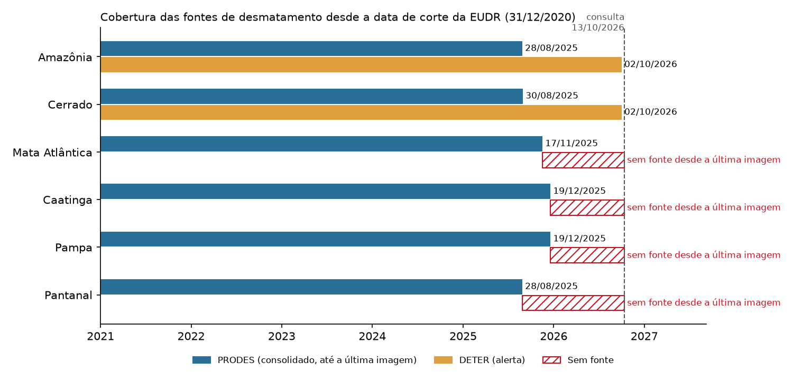
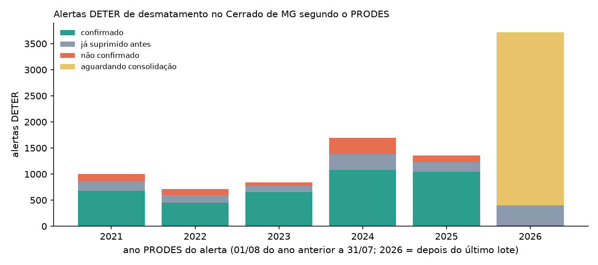
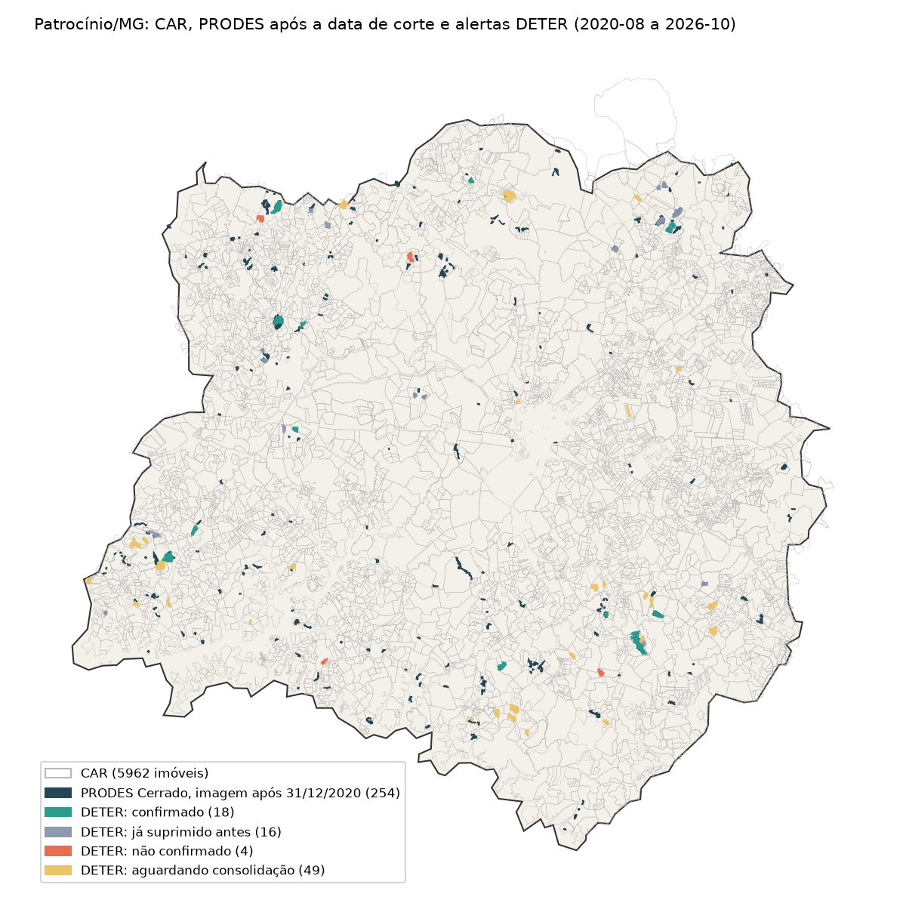

# Frente C — PRODES e a escada entre fontes de cadência diferente

Testes de 13/10/2026. A consulta e as validações estão em [`pipeline/fontes/inpe_prodes.py`](../../pipeline/fontes/inpe_prodes.py), e a consulta do DETER por ano PRODES em `inpe_deter.consultar_recorte`. O PRODES é consultado sob demanda, um ano por requisição, e cada resposta bruta fica em `data/raw/inpe_prodes/<bioma>/` com o `.meta.json`. Os números citados como "caderno, seção 6" são reproduzidos pelo caderno [`notebooks/02_fontes_antes_e_depois.ipynb`](../../notebooks/02_fontes_antes_e_depois.ipynb). Os citados como "estudo de 13/10/2026" vêm das consultas exploratórias daquela data (coleta por município e bioma, cobertura por bioma, mapa de Patrocínio), cujos scripts foram substituídos pelos módulos e não são repetidos no caderno.

## 1. Conclusão

| Pergunta | Resposta | Evidência |
|---|---|---|
| O PRODES cobre o recorte? | Sim. Dos 10 municípios cafeeiros do recorte, 75,9% da área está no Cerrado e 24,1% na Mata Atlântica, e os dois biomas têm PRODES até 2025. Na parte em Mata Atlântica, o PRODES é a única fonte de desmatamento | estudo de 13/10/2026 |
| A coleta é completa? | Sim. 57 de 57 requisições ao PRODES e 6 de 6 ao DETER com anunciado = recebido | estudo de 13/10/2026; caderno, seção 6, para o Cerrado de MG |
| Qual campo usar para a data de corte? | `image_date`, como recomenda o INPE. `publish_year` não é data de publicação: é sempre 01/01 do `year` | documento do INPE (seção Fontes); caderno, seção 6 |
| Filtrar por `year` deixa entrar imagem de 2020? | Não, no Cerrado de MG de 2019 a 2025: 0 polígonos de `year` ≥ 2021 com imagem até 31/12/2020, e 0 no sentido contrário | caderno, seção 6 |
| Então a data de corte está resolvida? | **Não.** `image_date` é a data da detecção, não a do desmatamento. 166 alertas DETER com imagem entre agosto e dezembro de 2020 (antes do corte) caem em polígonos do PRODES 2021, cuja imagem é de 2021 | caderno, seção 6 |
| Quanto o PRODES confirma do DETER? | No Cerrado de MG, de 2021 a 2025: 69,6% dos alertas (71,9% da área) confirmados, 16,7% em área já suprimida antes e 13,7% não confirmados | caderno, seção 6 |
| Até quando cada fonte cobre? | PRODES: imagens até agosto a dezembro de 2025, conforme o bioma. DETER (Amazônia e Cerrado): até 02/10/2026. Mata Atlântica, Caatinga, Pampa e Pantanal estão **sem fonte** desde a última imagem do PRODES | estudo de 13/10/2026 |

## 2. Calendário do PRODES (C1)

O documento do INPE sobre o uso do PRODES em conformidade ambiental (INPE, 2026; ver Fontes) define:

- **Incremento** é o desmatamento detectado no ano PRODES, "de 1º de agosto de um ano até 31 de julho do ano seguinte" (p. 9 do PDF). A data de detecção "pode variar um pouco, a depender do período ideal de detecção para cada região", e o período seco é o preferido.
- Para conformidade, deve-se usar a coluna `image_date`, "a data da imagem utilizada para mapear o desmatamento", "lembrando que para o Prodes, apenas o ano é considerado" (p. 13).
- Polígonos de **resíduo** não devem ser usados, porque a data de ocorrência não é precisa (p. 3). A coleta usa só `yearly_deforestation`.
- Para a regra da União Europeia (corte em 31/12/2020, sobreposição mínima de 0,5 ha), o INPE indica um mapa próprio, o **Marco UE**, com área mínima de 0,5 ha (p. 9 e 13). Esse mapa não está no WFS do TerraBrasilis: nenhuma das 93 camadas publicadas tem "eu", "marco" ou "2020" no nome (GetCapabilities, estudo de 13/10/2026).

O dado confirma o calendário e mostra o desvio:

| Ano PRODES (Cerrado, MG) | Polígonos | Área (km²) | Primeira imagem | Mediana | Última imagem | Imagens depois de 31/07 |
|---|---|---|---|---|---|---|
| 2019 | 5.551 | 475,90 | 02/07/2019 | 17/08/2019 | 11/09/2019 | 4.041 |
| 2020 | 8.657 | 620,73 | 02/07/2020 | 19/08/2020 | 08/10/2020 | 6.189 |
| 2021 | 10.368 | 800,64 | 05/07/2021 | 22/08/2021 | 16/09/2021 | 6.673 |
| 2022 | 10.254 | 801,37 | 06/07/2022 | 24/07/2022 | 11/09/2022 | 2.664 |
| 2023 | 8.360 | 704,70 | 30/06/2023 | 26/07/2023 | 25/09/2023 | 3.759 |
| 2024 | 6.374 | 509,28 | 12/07/2024 | 11/08/2024 | 25/08/2024 | 4.357 |
| 2025 | 7.144 | 508,15 | 11/07/2025 | 12/08/2025 | 28/08/2025 | 4.763 |

Fonte: caderno, seção 6 (consulta `state='MINAS GERAIS' AND year=<ano>`). Área pela soma de `area_km`.

Leitura:

1. O "ano 2021" tem imagens de julho a setembro de 2021. 57,2% dos polígonos de 2019 a 2025 (32.446 de 56.708, validação `PRODES_DATA_FORA_DO_ANO_PRODES`) têm imagem depois de 31/07 do próprio ano, ou seja, fora do intervalo nominal. O ano PRODES é o período de referência, não o intervalo das imagens.
2. Nenhuma imagem do "ano 2021" é de 2020. O receio do plano (o filtro por `year` deixar entrar imagem anterior ao corte) não se confirma no Cerrado de MG.
3. O problema real é outro: um polígono do PRODES 2021 registra a supressão ocorrida entre a imagem de 2020 (julho a outubro de 2020) e a de 2021. A parte entre a imagem de 2020 e 31/12/2020 é **anterior ao corte**, mas recebe `image_date` de 2021. O PRODES sozinho não separa os dois casos. No Cerrado, o DETER separa: 166 alertas com imagem entre 01/08 e 31/12/2020 foram confirmados pelo PRODES 2021 (caderno, seção 6). Na Mata Atlântica, sem DETER, a data fica incerta até o Marco UE ser obtido.

## 3. Coleta (C2)

Duas coletas, as duas no WFS do TerraBrasilis, camada `yearly_deforestation`:

- **Municípios do recorte:** os 10 maiores produtores de café de MG (definidos pela frente A, `config.MUNICIPIOS_CAFE_MG`). Para cada um, a parte dentro de cada bioma (camada de municípios do próprio PRODES) e todos os polígonos PRODES no retângulo do município, uma requisição por município e bioma.
- **Cerrado de MG, 2019 a 2025:** um ano por requisição, filtro `state='MINAS GERAIS' AND year=<ano>`, para o cruzamento com o DETER. O maior ano tem 10.368 polígonos.

| Coleta | Requisições | Anunciado = recebido | Registros |
|---|---|---|---|
| Malha IBGE dos municípios | 10 | 10 | 10 |
| Parte do município em cada bioma | 20 | 20 | 15 (Patrocínio, Monte Carmelo, Serra do Salitre e Rio Paranaíba não têm Mata Atlântica; Manhuaçu não tem Cerrado) |
| PRODES por município e bioma (todos os anos) | 20 | 20 | 13.789 Cerrado, 4.080 Mata Atlântica |
| PRODES Cerrado de MG por ano | 7 | 7 | 56.708 |
| DETER Cerrado de MG por ano PRODES | 6 | 6 | 9.332 |

Fonte: estudo de 13/10/2026. O caderno (seção 6) repete as duas últimas linhas com o módulo: o PRODES Cerrado de MG com uma requisição por ano de 2019 até o ano corrente (o ano sem dados volta vazio) e o DETER Cerrado de MG com uma requisição por ano PRODES, todas com anunciado = recebido.

Detalhes que o código precisa respeitar:

- O campo de UF muda de bioma para bioma: `MINAS GERAIS` no Cerrado, `MG` na Mata Atlântica (estudo de 13/10/2026). O módulo converte para a sigla (validação `PRODES_UF_NORMALIZADA`) e monta o filtro de UF conforme o bioma (`config.CAMADAS_PRODES`).
- No WFS 2.0 com EPSG:4674, o `BBOX` do filtro CQL recebe (latitude, longitude), mas o GeoJSON devolve (longitude, latitude). No retângulo de Patrocínio, a ordem (lat, lon) devolve 3.595 polígonos e a ordem (lon, lat), 0, sem erro (estudo de 13/10/2026, com a malha do IBGE em qualidade intermediária). O caderno (seção 6) repete o teste com a malha em qualidade máxima, cujo retângulo é um pouco maior: 3.596 e 0. A ordem fica em `config.ORDEM_EIXOS_FILTRO` e em `wfs.filtro_bbox`.
- O identificador é o `uuid` (é o número que o INPE pede no pedido de revisão). Os retângulos de municípios vizinhos se sobrepõem, e o mesmo polígono vem em duas respostas: 1.364 no Cerrado e 63 na Mata Atlântica, todos com atributos idênticos (estudo de 13/10/2026). A união é feita pelo `uuid`: o módulo descarta a repetição (`PRODES_UUID_DUPLICADO`).

## 4. Inconsistências (C3)

No Cerrado de MG (2019 a 2025, 56.708 polígonos) e nos municípios do recorte (13.789 no Cerrado, 4.080 na Mata Atlântica, todos os anos). A coluna do Cerrado de MG é reproduzida pelo caderno (seção 6) nas linhas que viraram validação do módulo (código na primeira coluna); as demais colunas e linhas são do estudo de 13/10/2026.

| Inconsistência | Cerrado MG | Cerrado recorte | Mata Atlântica recorte | Tratamento |
|---|---|---|---|---|
| `PRODES_UUID_AUSENTE`, `PRODES_UUID_DUPLICADO`: `uuid` nulo ou repetido na mesma resposta | 0 | 0 | 0 | descarte |
| `PRODES_CRS_INESPERADO`: CRS diferente de EPSG:4674 | 0 | 0 | 0 | erro |
| `PRODES_GEOM_AUSENTE`: geometria ausente | 0 | 0 | 0 | descarte |
| `PRODES_GEOM_INVALIDA`: geometria inválida (`is_valid`) | 4.966 (8,8%) | 1.654 | 541 | correção com `make_valid` |
| Pares de polígonos sobrepostos (> 100 m²) | 2.504 | 1.548 | 90 | alerta; área pela união, não pela soma |
| `PRODES_CLASSE_FORA_DO_DOMINIO`: `main_class` diferente de `DESMATAMENTO` | 0 | 0 | 116 (`RESERVATORIO`) | descarte |
| `PRODES_AREA_DIVERGENTE`: `area_km` difere mais de 10% da área da geometria | 763 | 192 | 60 | alerta; usar a área calculada |
| Área abaixo da mínima de 1 ha | 57 | 68 | 28 | alerta |
| `julian_day` diferente do dia de `image_date` | 113 | 195 | 0 | alerta; vale `image_date` |
| `PRODES_DATA_IMAGEM_AUSENTE`: `image_date` nula | 0 | 0 | 0 | alerta |
| `PRODES_DATA_FORA_DO_ANO_PRODES`: imagem fora de 01/08 a 31/07 do ano PRODES | 32.446 | 8.881 | 3.129 | alerta; informativo (seção 2) |
| `PRODES_PUBLISH_YEAR_DIVERGENTE`: `publish_year` diferente de 01/01 do `year` | 0 | 0 | 0 | campo ignorado: não informa a publicação |
| `PRODES_UF_NORMALIZADA`: UF por extenso | 56.708 | — | — | correção para a sigla |
| `def_cloud` preenchido | 0 | 0 | 269 (todos 0,0) | informativo |
| No retângulo, fora do município | — | 6.039 | 1.892 | fora do recorte |

Fonte: caderno, seção 6, e estudo de 13/10/2026. `PRODES_AREA_DIVERGENTE` dá 763 no módulo, que mede a área depois do `make_valid`; o estudo mediu a geometria original, inválida em 8,8% dos casos, e obteve 759. As colunas do recorte também são do estudo e usam a geometria original.

Também há grafias diferentes para o mesmo satélite e sensor (`Sentinel-2` e `sentinel 2B`; `MSI` e `MSIL 1 C`) e, na Mata Atlântica, 640 polígonos com `source` = `antigo cerrado` nos retângulos do recorte. Só o Cerrado e o Pampa têm `pub_date`, a data em que a camada foi publicada (estudo de 13/10/2026).

## 5. Cobertura por bioma (C4)

| Bioma | PRODES: última imagem | PRODES: publicação | DETER: última imagem | Situação em 13/10/2026 |
|---|---|---|---|---|
| Amazônia | 28/08/2025 | não informada na camada | 02/10/2026 | DETER cobre o período depois do PRODES |
| Cerrado | 30/08/2025 | 17/07/2026 (`pub_date`) | 02/10/2026 | DETER cobre o período depois do PRODES |
| Mata Atlântica | 17/11/2025 | não informada na camada | — | **sem fonte desde 17/11/2025** |
| Caatinga | 19/12/2025 | não informada na camada | — | **sem fonte desde 19/12/2025** |
| Pampa | 19/12/2025 | 07/08/2026 (`pub_date`) | — | **sem fonte desde 19/12/2025** |
| Pantanal | 28/08/2025 | não informada na camada | — | **sem fonte desde 28/08/2025** |

Fonte: estudo de 13/10/2026 (registro mais recente de cada camada, ordenado pelo serviço com `sortBy`). O último ano publicado é 2025 em todos os biomas.

No recorte, a lacuna pesa: 24,1% da área dos 10 municípios está na Mata Atlântica, onde nada cobre o período depois de 17/11/2025.

| Município | Bioma | Parte do município | PRODES com imagem depois de 31/12/2020 | Desses, do ano 2021 | Área (km²) | DETER |
|---|---|---|---|---|---|---|
| Patrocínio | Cerrado | 100% | 256 | 71 | 13,46 | sim |
| Monte Carmelo | Cerrado | 100% | 202 | 49 | 10,62 | sim |
| Araguari | Cerrado | 77% | 89 | 19 | 7,39 | sim |
| Rio Paranaíba | Cerrado | 100% | 84 | 23 | 6,92 | sim |
| Serra do Salitre | Cerrado | 100% | 80 | 22 | 5,16 | sim |
| Campos Gerais | Cerrado | 63% | 18 | 3 | 0,38 | sim |
| Ibiraci | Cerrado | 55% | 10 | 5 | 0,52 | sim |
| Três Pontas | Cerrado | 25% | 1 | 0 | 0,13 | sim |
| Manhuaçu | Mata Atlântica | 100% | 128 | 5 | 2,78 | **não** |
| Araguari | Mata Atlântica | 23% | 19 | 5 | 0,74 | **não** |
| Campos Gerais | Mata Atlântica | 37% | 15 | 5 | 0,25 | **não** |
| Três Pontas | Mata Atlântica | 75% | 6 | 1 | 0,08 | **não** |
| Ibiraci | Mata Atlântica | 45% | 5 | 1 | 0,17 | **não** |
| Alfenas | Mata Atlântica | 100% | 4 | 0 | 0,08 | **não** |

Fonte: estudo de 13/10/2026. Partes calculadas com área aproximada (projeção local); por isso há parcelas de 100,8%, arredondadas para 100%. Alfenas tem 0,2 km² no Cerrado, sem PRODES.

## 6. DETER × PRODES no Cerrado de MG (C5)

Para cada alerta DETER de desmatamento em MG (mesmas classes do pipeline), com imagem na data *d*:

- **confirmado:** polígonos PRODES com imagem em *d* ou depois cobrem ao menos 10% do alerta;
- **já suprimido antes:** a cobertura de 10% só existe com PRODES de imagem anterior a *d* (o alerta caiu em área já desmatada);
- **não confirmado:** nenhuma das duas, e *d* está num ano PRODES já publicado;
- **aguardando consolidação:** nenhuma das duas, e *d* é depois de 31/07/2025 (o último ano publicado).

| Ano PRODES do alerta | Confirmado | Já suprimido antes | Não confirmado | Aguardando | Total |
|---|---|---|---|---|---|
| 2021 | 681 | 188 | 131 | 0 | 1.001 |
| 2022 | 453 | 141 | 121 | 0 | 715 |
| 2023 | 652 | 122 | 65 | 0 | 841 |
| 2024 | 1.078 | 301 | 319 | 0 | 1.699 |
| 2025 | 1.043 | 183 | 134 | 0 | 1.360 |
| depois de 31/07/2025 | 17 | 382 | 0 | 3.316 | 3.716 |
| **Total** | **3.924** | **1.317** | **770** | **3.316** | **9.332** |

Fonte: caderno, seção 6 (`inpe_prodes.confirmar_alertas`). Lá o período depois de 31/07/2025 aparece dividido em ano PRODES 2026 e 2027 (alertas a partir de 01/08/2026); a soma é a da última linha. 5 alertas têm geometria sem área e ficam fora da regra (incluídos no total).

Nos anos consolidados (2021 a 2025), **69,6%** dos alertas (3.907 de 5.612) e 71,9% da área foram confirmados (caderno, seção 6). Os 13,7% não confirmados são o falso positivo do DETER que o PRODES corrige. Os 16,7% "já suprimidos antes" são alertas sobre área que o PRODES já tinha registrado: não é desmatamento novo naquela data.

Os 3.316 alertas depois de julho de 2025 mostram por que o DETER é indispensável no Cerrado: o PRODES de 2026 ainda não existe.

### Mapa do recorte: Patrocínio

| Item | Quantidade | Área (km²) |
|---|---|---|
| Imóveis CAR | 5.962 | 2.588,30 |
| PRODES Cerrado com imagem depois de 31/12/2020 | 254 | 13,50 |
| Desses, tocando algum CAR | 245 | 12,86 |
| Alertas DETER confirmados | 18 | 2,98 |
| Alertas DETER em área já suprimida | 16 | 1,49 |
| Alertas DETER não confirmados | 4 | 0,52 |
| Alertas DETER aguardando consolidação | 49 | 3,85 |

Fonte: estudo de 13/10/2026. O CAR é o da frente A. Aqui os polígonos PRODES são os que tocam o limite IBGE do município (254); na tabela da seção 5, os que tocam a parte do município no Cerrado (256).

## 7. Escada entre fontes

Cada evidência de desmatamento carrega fonte, data da imagem, ano PRODES, data de publicação (quando a camada informa) e bioma. Regra explícita (nível 1), sem ML. Em relação ao plano, entram as linhas 3, 4 e 7, que vêm das seções 2 e 6.

| # | Situação | Fonte que vale | Estado exibido |
|---|---|---|---|
| 1 | Amazônia ou Cerrado, alerta DETER depois do último ano PRODES | DETER | "Alerta não consolidado", com data da imagem |
| 2 | PRODES com imagem posterior ao corte, ano PRODES ≥ 2022 | PRODES | "Supressão confirmada", com data da imagem |
| 3 | PRODES do ano 2021 sobre alerta DETER com imagem até 31/12/2020 | PRODES + DETER | "Supressão detectada em 2021, com alerta anterior ao corte": indício de supressão **antes** do corte |
| 4 | PRODES do ano 2021 sem DETER (Mata Atlântica, Caatinga, Pampa, Pantanal) | PRODES | "Supressão entre a imagem de 2020 e a de 2021": data incerta em relação ao corte; consultar o Marco UE |
| 5 | Alerta DETER em ano PRODES publicado, sem polígono PRODES | PRODES; o alerta fica registrado | "Alerta não confirmado pela consolidação" |
| 6 | Alerta DETER sobre PRODES com imagem anterior ao alerta | PRODES | "Área já suprimida antes do alerta", com a data do PRODES |
| 7 | Bioma sem DETER, depois da última imagem PRODES | Nenhuma | **"Sem cobertura de [última imagem] até hoje"**: inconclusivo, nunca "sem pendência" |

A linha 7 protege contra o falso negativo: um bioma sem fonte recente não aparece como limpo. A linha 3 protege contra o falso positivo da data de corte: no Cerrado de MG, 166 alertas estão nessa situação (caderno, seção 6).

Os limiares (10% do alerta) e a comparação pela data da imagem estão em [ADR 0009](../arquitetura/adr/0009-combinar-deter-e-prodes-por-data-de-imagem-e-cobertura.md).

## 8. Situação das tarefas

| # | Pronto quando | Situação |
|---|---|---|
| C1 | Regra de filtro pela data de corte justificada | Concluída. Filtro por `image_date`, com fonte do INPE; acrescida a janela de agosto a dezembro de 2020 (seção 2) |
| C2 | Anunciado = recebido | Concluída. 57 de 57 (PRODES) e 6 de 6 (DETER) |
| C3 | Mesmo nível do estudo do DETER | Concluída. 19 verificações no Cerrado de MG e 21 nos conjuntos por município, com contagem e tratamento |
| C4 | Datas lidas do serviço, não de notícia | Concluída. Registro mais recente de cada camada, com resposta bruta |
| C5 | Taxa de confirmação medida | Concluída. 69,6% nos anos 2021 a 2025 |
| C6 | ADR no formato MADR | Concluída. ADR 0009 |

Pendências:

- **Marco UE.** O mapa do INPE para a data de corte da UE não está no WFS. Falta localizar o download e testar se resolve a linha 4 da escada.
- **Mata Atlântica fora do recorte de teste.** A coleta da Mata Atlântica foi feita só nos 10 municípios; o cruzamento com o DETER não se aplica a ela.
- **Mapa com embargos.** O mapa de Patrocínio não inclui os embargos do IBAMA; a atribuição embargo → CAR é da frente A.

## 9. Fechamento

- **Código:** `pipeline/fontes/inpe_prodes.py` (`consultar` por bioma, retângulo ou UF e ano; validações da seção 4; `confirmar_alertas` com a regra da seção 6), `inpe_deter.consultar_recorte` (DETER por ano PRODES, com o tratamento do lote) e `pipeline/wfs.py` (requisição, contagem e filtros comuns, com a ordem dos eixos em `config.ORDEM_EIXOS_FILTRO`). `make_valid` vem antes de qualquer interseção.
- **Testes:** `tests/test_inpe_prodes.py` (descarte de classe e de `uuid` repetido, UF normalizada, imagem fora do ano PRODES, partição incompleta, filtro em (lat, lon) e as quatro situações da regra de confirmação).
- **Documentos:** seção do PRODES em [`inconsistencias-dos-dados.md`](../inconsistencias-dos-dados.md) e fontes sob demanda em [`arquitetura.md`](../arquitetura/arquitetura.md).
- **Pendente:** o servidor `www.inpe.br` não envia o certificado intermediário (`unable to get local issuer certificate`); o documento do INPE não é baixado pelo pipeline.

## Fontes

- TerraBrasilis, WFS do PRODES e do DETER: `https://terrabrasilis.dpi.inpe.br/geoserver/ows` (consultado em 13/10/2026)
- INPE. *O uso dos dados do Prodes para avaliar a conformidade ambiental de propriedades rurais*. INPE, 2026. `https://www.inpe.br/canal-atendimento-biomasbr/core/files/Uso_Prodes_conformidade_ambiental_260408.pdf` (consultado em 13/10/2026; SHA-256 do PDF baixado: `934ba0ada397742ad27e5cf09c16e3aa612d2a4cb27e5161d660e41059cd36fd`)
- IBGE, API de malhas municipais: `https://servicodados.ibge.gov.br/api/v3/malhas/municipios/` (consultado em 13/10/2026)
