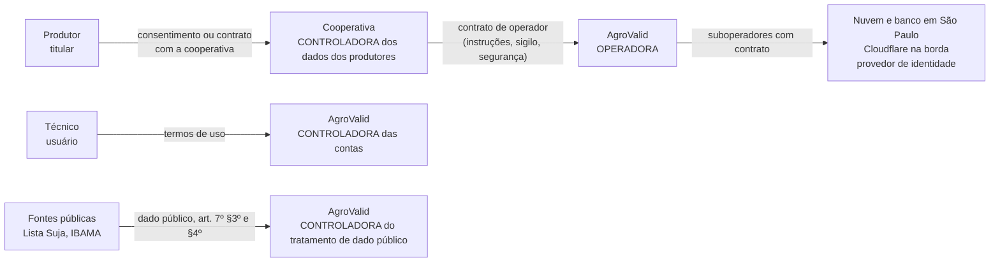

# Módulo LGPD da AgroValid

Situação: **rascunho de 05/11/2026, para lapidar. Precisa de revisão jurídica antes de qualquer titular real.** Decisão de arquitetura no [ADR 0025](../arquitetura/adr/0025-tratar-a-lgpd-por-desenho-com-dado-pessoal-no-brasil.md).

Base: [Lei 13.709/2018 (LGPD)](https://www.planalto.gov.br/ccivil_03/_ato2015-2018/2018/lei/l13709.htm) e as resoluções da [ANPD](https://www.gov.br/anpd/pt-br): CD/ANPD nº 2/2022 (agentes de pequeno porte), nº 15/2024 (comunicação de incidente), nº 18/2024 (encarregado) e nº 19/2024 (transferência internacional).

| Documento | Para quê |
|---|---|
| [`inventario-e-bases-legais.md`](inventario-e-bases-legais.md) | Registro das operações (art. 37): que dado, para quê, com qual base legal, onde fica e por quanto tempo |
| [`direitos-incidentes-e-retencao.md`](direitos-incidentes-e-retencao.md) | Atendimento ao titular (art. 18), decisão automatizada (art. 20), incidente (art. 48) e descarte |
| [`modelos/`](modelos/) | Rascunhos: política de privacidade, termos de uso, contrato de operador com a cooperativa, termo de consentimento do produtor |

## Papéis

## Princípios aplicados ao sistema

| Princípio (art. 6º) | Como o sistema cumpre |
|---|---|
| Finalidade e adequação | Só pré-diagnóstico socioambiental e atendimento da cooperativa; nada de perfil comercial ou venda de dado |
| Necessidade (minimização) | CPF e CNPJ nunca em claro (HMAC, ADR 0002); a planilha não pede nome do produtor; log sem dado pessoal |
| Livre acesso e transparência | Política de privacidade pública; a ficha mostra fonte, data e o que não foi verificado |
| Qualidade | Fonte com data e SHA-256; dado incompleto vira "inconclusivo", nunca "sem ocorrência" (ADR 0013) |
| Segurança e prevenção | RLS por organização, papéis mínimos, nenhum token no navegador, borda com WAF ([segurança](../arquitetura/evolucao/seguranca.md)) |
| Não discriminação | O sistema nunca diz "conforme" nem decide; o técnico decide e o titular pode pedir revisão |
| Responsabilização | Este módulo, os ADRs e o histórico do repositório são a prova do que foi feito e quando |

## Antes do piloto (fase 3)

- [ ] Revisão jurídica dos modelos.
- [ ] Contrato de operador assinado com a cooperativa piloto.
- [ ] Política de privacidade e termos publicados no front.
- [ ] Encarregado indicado e canal do titular publicado (mesmo se a dispensa de pequeno porte se aplicar, manter o canal).
- [ ] RIPD (relatório de impacto, art. 38) para o pré-diagnóstico, por envolver resultado que pode afetar crédito.
- [ ] Contratos e cláusulas de transferência com os suboperadores (nuvem, banco, Cloudflare, provedor de identidade).
- [ ] Teste do plano de incidente (simulação).
