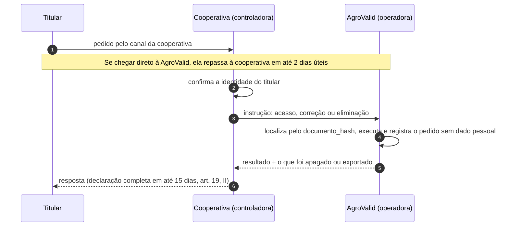
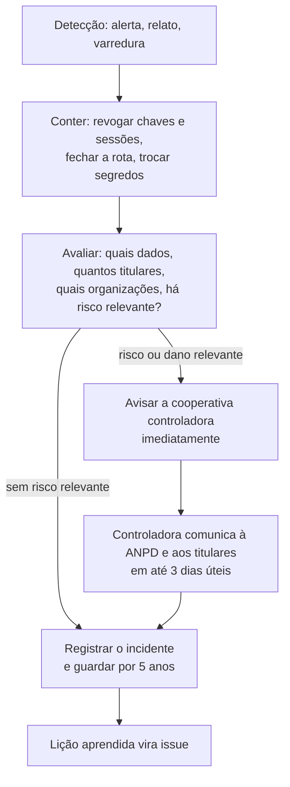

# Direitos do titular, decisão automatizada, incidentes e retenção

Rascunho de 05/11/2026, para lapidar.

## Pedido do titular (art. 18)

O produtor pode pedir: confirmação de tratamento, acesso, correção, anonimização ou eliminação, portabilidade, informação sobre compartilhamento e revogação do consentimento. Como a cooperativa é a controladora dos dados dele, o pedido é atendido por ela, com a AgroValid executando.

- **Eliminação:** apaga as linhas de `cad` e `diag` do titular naquela organização, inclusive no lago (partição da organização). As cargas de dado público não mudam, porque não pertencem à cooperativa.
- **Revogação do consentimento:** a mesma eliminação, mais um bloqueio para o hash não voltar na próxima carteira sem novo consentimento.

## Decisão automatizada (art. 20)

O pré-diagnóstico ordena a carteira e aponta pendências, o que pode influir em crédito ou venda. Por isso:
- o sistema nunca decide nem diz "conforme"; o técnico decide;
- a ficha explica cada critério com a fonte, a data e o que não foi verificado;
- o titular pode pedir revisão por uma pessoa, pelo canal da cooperativa.

## Incidente de segurança (art. 48 e Resolução CD/ANPD nº 15/2024)

- Guardar o registro de todo incidente, mesmo sem comunicação, por pelo menos 5 anos (Resolução nº 15/2024).
- O contrato de operador obriga a AgroValid a avisar a cooperativa sem demora, para que ela cumpra o prazo.

## Retenção e descarte

| Dado | Prazo proposto | Como descarta |
|---|---|---|
| Carteira, pré-diagnóstico e documentos pseudonimizados | Contrato + 6 meses | Rotina que apaga a organização em `cad`/`diag` e no lago |
| Contas de usuário inativas | 6 meses após a desativação | Exclusão no provedor de identidade |
| Log de acesso | 6 meses (Marco Civil, art. 15) | Expiração automática |
| Backups | Rotação do provedor (7 dias no Pro) | Expiração automática; a eliminação vale também para backups depois do ciclo |
| Registro de incidentes | 5 anos | Sem dado pessoal, só descrição |
